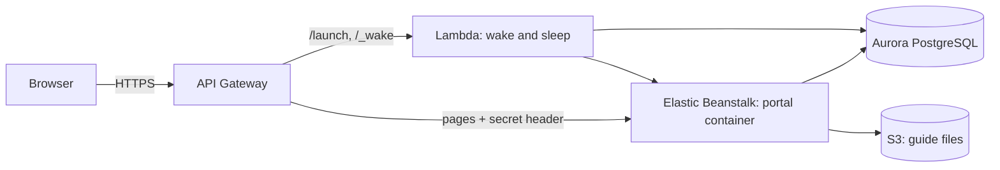
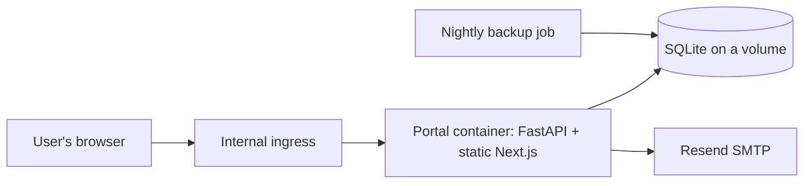

# Architecture: Cloud Internal Developer Portal

*Last updated: 2026-10-29*

## Overview

A web app with a Python (FastAPI) backend and a Next.js frontend, packaged as one Docker container. The backend serves both the API and the static frontend. Data is in SQLite on a Kubernetes volume. Users sign in with the portal's own email-and-password accounts; email goes out through SMTP (Resend).

## On AWS (class project)

Beanstalk runs the container; data is in Aurora PostgreSQL and attached files in S3 (decision 0005). In hibernate mode a Lambda function puts Aurora and the instance to sleep when idle; the launcher link (API Gateway) wakes them and forwards to the portal (decision 0006). API Gateway is also the portal's HTTPS address; the app refuses requests that didn't come through it, signs in to Aurora as its own `portal_app` user, and gets its secrets from SSM Parameter Store (decision 0007). Setup: [aws-learner-lab.md](aws-learner-lab.md).

## Diagram (original on-premises design)

## Parts of the app

| Part | Technology | What it does |
| --- | --- | --- |
| Web frontend | Next.js (static export), React, PrimeReact, Tailwind | Catalog, system pages, forms and checklists |
| API / backend | Python 3.11, FastAPI, SQLAlchemy | Data, permissions, checklist rules, change history |
| Database migrations | Alembic | Creates and changes tables on every deploy |
| Database | SQLite locally; Aurora PostgreSQL on AWS (`DB_HOST` or `DATABASE_URL`) | All portal data except attached files |
| File storage | S3 (`DOCS_BUCKET`), versioned; the database when unset | Markdown files attached to the handover guide |

The data model is in [data-model.md](data-model.md).

## Data

| Data | Where it is stored | Personal or confidential? | Backed up? |
| --- | --- | --- | --- |
| People: names, emails, units | `person`, `unit` tables | Personal (staff contact details) | Yes, nightly |
| Systems and their details | `system` and related tables | Some fields confidential (see below) | Yes, nightly |
| Checklist answers, review notes | `checklist_answer`, `review_note` tables | No | Yes, nightly |
| Attached markdown files (runbooks) | S3 objects `systems/<id>/<question>/<file>`; the `guide_doc` row keeps key and checksum | May describe servers; bucket is private | S3 versioning keeps old copies |
| Change history | `change_log` table | Contains names of who changed what | Yes, nightly |

## Login and permissions

- Everyone signs in with their email and a password the portal stores as a slow salted hash (decision 0004). Signing up sends a link to verify the address; then an admin approves the account on the Users page. Forgotten passwords are replaced through an emailed link. Ten wrong passwords in an hour lock the account for 20 minutes.
- An admin's name in the header opens the admin menu: **ผู้ใช้** (suspend accounts, grant admin or auditor, send the password-reset link), **จัดการคำขอ** (approve or reject sign-ups; the count of waiting ones shows on the name) and **ประวัติการใช้งาน** (account events: sign-ins, failed sign-ins, lockouts, sign-ups, approvals, password resets, with time and IP; table `activity_log`).
- Every signed-in user can see every system and register a new one. The person who registers a system becomes its technical owner.
- A system's owners and developers can edit it. Admins can edit everything and manage checklist items.
- Confidential fields (server or location, data storage location, backup details, known vulnerabilities) are shown only to the system's owners, developers and admins.
- Any signed-in user can add a review note.
- The first admin comes from `SEED_ADMIN_EMAIL` / `SEED_ADMIN_PASSWORD`. Without SMTP settings (local development), emails are written to the server log.

## Connections to other systems

| System | What we use it for |
| --- | --- |
| Resend (SMTP) | Emails to confirm an address at sign-up and to reset a password; nothing else |
| Knowledge base site | Each checklist item links to the page that explains it |

## Settings

All settings are listed in `.env.example`. Secrets are stored in the GitLab CI/CD variables and Kubernetes secrets, never in the repository.

## Decisions

See the decision records in [decisions/](decisions/).
