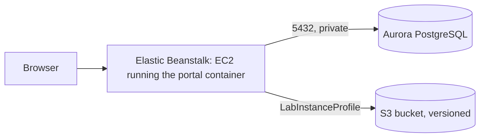
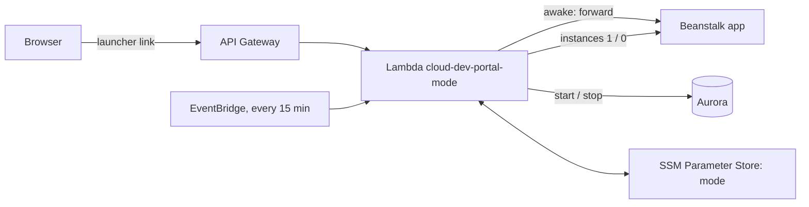

# Deploying to AWS Academy Learner Lab

*Last updated: 2026-11-01*

How to run the portal on AWS with Elastic Beanstalk (the app), Aurora PostgreSQL (data) and S3 (the guide's markdown files). Cognito comes later; until then the portal keeps its own accounts and writes emails to the log.



## Rules of the Learner Lab

- Work in **us-east-1** (N. Virginia). Other regions are blocked.
- You can't create IAM roles. Wherever AWS asks for a role, pick **LabRole**; for EC2 it's **LabInstanceProfile**.
- A session lasts 4 hours. When it ends, EC2 instances stop and start again with the next session. Aurora and S3 keep running and keep costing money: stop Aurora yourself after each work session (see [Saving budget](#saving-budget)).
- Watch the budget shown on the lab page. Aurora costs the most; see [Saving budget](#saving-budget).

Start the lab, wait for the dot to turn green, then click **AWS** to open the console. Check the region in the top-right corner says N. Virginia.

## Tags

Give every resource the same tags, so they can be listed together (Resource Groups & Tag Editor → filter on `Project`). Keys and values are case-sensitive.

| Key | Value |
| --- | --- |
| `Project` | `cloud-dev-portal` |
| `Name` | the resource's own name, e.g. `portal-db-sg` (security groups show it in the Name column) |
| `Environment` | `dev` |

Beanstalk copies its tags to the EC2 instance and the other resources it creates. Leave out `Name` there: Beanstalk reserves it and sets it to the environment's name ("Tag key 'Name' is reserved").

## 1. Security groups

EC2 → **Security Groups** → **Create security group**, both in the default VPC:

| Name | Inbound rules | Purpose |
| --- | --- | --- |
| `portal-app-sg` | none | Put on the portal's EC2 instance, so the database can trust it |
| `portal-db-sg` | PostgreSQL (5432), source: `portal-app-sg` | Put on Aurora: only the portal can reach it |

Create `portal-app-sg` first: the rule on `portal-db-sg` points to it.

## 2. S3 bucket for the markdown files

S3 → **Create bucket**:

- **Bucket name:** something unique, e.g. `cloud-dev-portal-docs-<your-student-id>`
- **Block all public access:** on (the default)
- **Bucket Versioning:** **Enable**. Every replaced or removed file stays recoverable.
- **Default encryption:** SSE-S3 (the default)

Write down the name; it becomes `DOCS_BUCKET`.

## 3. Aurora PostgreSQL

RDS → **Create database**:

| Setting | Value |
| --- | --- |
| Creation method | Standard create |
| Engine | **Aurora (PostgreSQL Compatible)**, latest version offered |
| Template | Dev/Test |
| DB cluster identifier | `portal-db` |
| Master username | `portal` |
| Credentials management | **Self managed**, type a password (letters and digits are easiest) and write it down |
| Cluster storage configuration | Aurora Standard |
| Cluster scalability type | **Provisioned**. Learner Lab refuses Aurora Serverless: creation fails with "not authorized to perform rds:CreateDBInstance … explicit deny" |
| DB instance class | Burstable classes → **db.t3.medium** (or db.t4g.medium), the smallest Aurora PostgreSQL offers. It runs, and bills about $2 a day, until you stop it |
| Multi-AZ | Don't create an Aurora Replica |
| VPC | Default VPC |
| Public access | **No** |
| VPC security group | Choose existing: **`portal-db-sg`** (remove `default`) |
| Monitoring | **Turn off Enhanced Monitoring and Performance Insights**. They need an IAM role the lab can't create, and creation fails otherwise |
| Additional configuration → **Initial database name** | **`portal`**. Without it there is no database for the app to use |
| Backup retention | 1 day |
| Deletion protection | Off (so you can delete it at the end of the course) |

Don't use **Easy create / express configuration**: it uses IAM-only database login (the app signs in with a password) and puts the database outside the VPC, and neither can be changed later.

If a failed attempt left a `portal-db` cluster with no instance, delete it before trying again.

Creating the cluster takes 5 to 10 minutes. Then open `portal-db` → **Connectivity & security** and copy the **writer** endpoint (`portal-db.cluster-xxxx.us-east-1.rds.amazonaws.com`). It becomes `DB_HOST`.

## 4. Build the app bundle

Beanstalk builds the [Dockerfile](../Dockerfile) on the instance, so upload the source as a zip. `git archive` packs only committed files, so commit first:

```bash
git archive -o portal.zip HEAD
```

## 5. Elastic Beanstalk

Elastic Beanstalk → **Create application**.

**Step 1: Configure environment**

- Environment tier: **Web server environment**
- Application name: `cloud-dev-portal`
- Platform: **Docker**, branch "Docker running on 64bit Amazon Linux 2023"
- Application code: **Upload your code**, version label `v1`, choose `portal.zip`
- Presets: **Single instance** (cheapest; no load balancer). Choose "High availability" later to show auto scaling.

**Step 2: Configure service access**

- Service role: **Use an existing service role → LabRole**
- EC2 key pair: `vockey` (optional, lets you SSH in)
- EC2 instance profile: **LabInstanceProfile**. This is what lets the app use S3 without keys.

**Step 3: Networking, database and tags**

- VPC: the default VPC; **Public IP address: Activated**; tick one or two subnets
- Database: leave it off. Aurora is separate, not created by Beanstalk.

**Step 4: Instance traffic and scaling**

- EC2 security groups: tick **`portal-app-sg`** (keep the one Beanstalk adds)
- Instance types: **t3.small** only. Building the frontend needs about 2 GB of memory; if the first deploy fails while building, switch to t3.medium.

**Step 5: Updates, monitoring and logging**

- Health reporting: Basic (Enhanced also works with LabRole)
- Managed updates: off
- **Environment properties** (the portal's settings):

| Name | Value |
| --- | --- |
| `ENVIRONMENT` | `staging` (not `production` yet: that requires SMTP and HTTPS) |
| `JWT_SECRET_KEY` | 48+ random characters: `python -c "import secrets; print(secrets.token_urlsafe(48))"` |
| `DB_HOST` | the Aurora writer endpoint |
| `DB_NAME` | `portal` |
| `DB_USER` | `portal` |
| `DB_PASSWORD` | the Aurora password |
| `DOCS_BUCKET` | your bucket name |
| `AWS_REGION` | `us-east-1` |
| `SEED_ADMIN_EMAIL` | your email: the first admin |
| `SEED_ADMIN_PASSWORD` | 12+ characters |

**Step 6: Review → Submit.** The first launch takes about 10 minutes (it builds the image). When the environment shows **Ok**, open its URL (`cloud-dev-portal-env.eba-xxxx.us-east-1.elasticbeanstalk.com`) and sign in with the seed admin.

Then add one more property so links in emails point to the portal: `PUBLIC_BASE_URL` = that URL, starting with `http://`.

**Health check:** Configuration → Instance traffic and scaling (with a load balancer: Processes) → set the health check path to `/api/health`.

On every start, the container brings the Aurora tables up to date (`alembic upgrade head`) and loads the checklist standards. To add the four demo systems, connect to the instance (EC2 → the instance → Connect) and run:

```bash
sudo docker exec $(sudo docker ps -q) python -m app.seed --demo
```

## 6. Check it works

1. Open a system → handover guide → attach a `.md` file.
2. S3 → your bucket: the file is at `systems/<id>/<question>/<file>.md`. Replace it in the portal, then turn on **Show versions** in S3 to see both copies.
3. Emails (sign-up verification, password reset) are in the log until Cognito replaces them: Beanstalk → **Logs → Request logs → Last 100 lines**.

## Deploying a new version

```bash
git archive -o portal.zip HEAD
```

Beanstalk → your environment → **Upload and deploy** → choose `portal.zip`, give it a new version label.

## Saving budget

- **Use hibernate mode** ([below](#active-and-hibernate-modes)): the portal then sleeps by itself when nobody uses it. Until it is set up, stop Aurora by hand as described next.
- **Stop Aurora after every work session.** `db.t3.medium` bills about $0.08 an hour whenever it runs, even with the lab session off: left on, it alone uses up a $50 budget in under a month.
  - Finishing: RDS → Databases → select the cluster `portal-db` → **Actions → Stop temporarily**. Stopped, it costs only storage.
  - Starting: **Actions → Start**, and wait about 5 minutes for **Available** before opening the portal (until then it shows database errors).
  - AWS starts a stopped cluster again by itself after 7 days: stop it again if you haven't worked on the project for a week.
  - Some courses stop RDS when the lab session ends; check the lab's Readme, and don't rely on it otherwise.
- Single-instance Beanstalk avoids paying for a load balancer.
- Never create a NAT Gateway: it bills by the hour and isn't needed here.
- At the end of the course: terminate the Beanstalk environment, delete the Aurora cluster (skip the final snapshot), empty and delete the bucket.

## Active and hibernate modes

Two modes, switched with one click:

| | **Active** (presentation days) | **Hibernate** (development days) |
| --- | --- | --- |
| Aurora and the Beanstalk instance | Always on | Asleep when nobody uses the portal |
| Goes to sleep | Never | After 30 minutes without visitors (checked every 15 minutes) |
| Opening the site | Instant | Through the **launcher link**: while asleep it shows a "waking up" page, and forwards to the portal after 5–10 minutes |
| Cost | About $2.50 a day | Storage only while asleep |



- **The launcher link** is the API Gateway address. Share it instead of the Beanstalk address. Opening it while the portal is awake forwards straight to the portal. While it sleeps, it shows the waking-up page.
- **The waking-up page** asks the Lambda function to start Aurora and the Beanstalk instance, checks every 10 seconds, and forwards to the portal when both are up.
- **EventBridge** runs the function every 15 minutes. In hibernate mode it asks the portal how long it has been idle (`/api/health` reports it) and puts it to sleep after 30 minutes.
- **The mode** is kept in SSM Parameter Store, `/cloud-dev-portal/mode`.
- The code: [infra/portal_mode/](../infra/portal_mode/) (the function and the waking-up page; [infra/portal_mode.zip](../infra/portal_mode.zip) is the same, ready to upload, rebuilt with `python scripts/build_lambda_zip.py`), [infra/sleep-wake.yaml](../infra/sleep-wake.yaml) (CloudFormation), [scripts/portal_mode.py](../scripts/portal_mode.py).

> **Why not CloudFront?** CloudFront could show the waking-up page at the portal's own address, and give it HTTPS, so nobody would need a separate link. AWS Academy Learner Lab doesn't allow CloudFront: every call is refused (`not authorized to perform: cloudfront:ListDistributions … because no identity-based policy allows`). The launcher link does the same job with API Gateway, which the lab allows. The one difference: opening the Beanstalk address directly while the portal sleeps just fails, so share the launcher link.

### Two ways to set it up

The same four pieces can be built two ways. Both give the same result; pick one.

- **[Option A: by hand in the console](#option-a-set-it-up-by-hand-in-the-console)**: about an hour. You create each piece yourself and see what it does and how they connect. Best for learning.
- **[Option B: with CloudFormation](#option-b-set-it-up-with-cloudformation)**: about 15 minutes. One template ([infra/sleep-wake.yaml](../infra/sleep-wake.yaml)) creates all of it and deletes it again in one step. Infrastructure as code.

Before either: the Beanstalk environment works (step 6), and you have its **name** from its page, e.g. `cloud-dev-portal-env`. The steps below write it as `<environment name>`.

### Option A: set it up by hand in the console

You build the pieces in the order they depend on each other: the function first, since everything else calls it.

| Step | Piece | Its job |
| --- | --- | --- |
| A1 | Lambda function | Does the work: switches modes, starts and stops Aurora and the instance, answers the launcher link |
| A2 | SSM parameter | Remembers the current mode between runs |
| A3 | EventBridge rule | Runs the function every 15 minutes to put an idle portal to sleep |
| A4 | API Gateway | The launcher link: lets a browser reach the function over HTTPS |
| A5 | Finishing | Saves the switches; tests the whole system |

#### A1. Lambda function

The function's code is ready in [infra/portal_mode.zip](../infra/portal_mode.zip): `handler.py` (the function) and `wake.html` (the waking-up page). Download it from the repository.

1. Lambda → **Create function** → **Author from scratch**.
   - Function name: **`cloud-dev-portal-mode`**
   - Runtime: **Python 3.12**
   - Permissions → *Change default execution role* → **Use an existing role** → **LabRole**
   - **Create function**.
2. **Code** tab → **Upload from** → **.zip file** → choose `portal_mode.zip` → **Save**. The file list on the left now shows `handler.py` and `wake.html`.
3. **Code** tab → **Runtime settings** → **Edit** → Handler: **`handler.lambda_handler`** → **Save**.
4. **Configuration** → **General configuration** → **Edit** → Timeout: **30 sec** → **Save**. (Starting Aurora and reading the app's state takes longer than the default 3 seconds.)
5. **Configuration** → **Environment variables** → **Edit** → add:

| Key | Value | Meaning |
| --- | --- | --- |
| `DB_CLUSTER_ID` | `portal-db` | The Aurora cluster to start and stop |
| `EB_ENVIRONMENT` | `<environment name>` | The Beanstalk environment whose instance count changes |
| `PARAM_PREFIX` | `/cloud-dev-portal` | Where A2's parameter lives |
| `IDLE_MINUTES` | `30` | In hibernate mode, sleep after this many minutes without visitors |

6. Add the tags `Project = cloud-dev-portal` and `Environment = dev` (**Configuration** → **Tags**).

**Checkpoint.** **Test** tab → Create new event, name `status`, Event JSON `{"action": "status"}` → **Test**. The result shows the portal's state:

```json
{"mode": "hibernate", "database": "available", "app_instances": 1, "app_answers": true, "idle_minutes": 2, "ready": true}
```

`"mode"` says `hibernate` until A2 exists; that's expected. If the result is an `AccessDenied` error instead, LabRole doesn't allow that action in your course: read the message for the action's name, see [Things to know](#things-to-know), and stop here.

#### A2. SSM parameter

Systems Manager → **Parameter Store** → **Create parameter**:

- Name: **`/cloud-dev-portal/mode`**
- Tier: Standard · Type: **String** · Data type: text
- Value: **`active`**. Start in active, so nothing goes to sleep while you build the rest.
- Tags: `Project = cloud-dev-portal`, `Environment = dev`

**Checkpoint.** Run the `status` test event again: `"mode"` is now `active`.

#### A3. EventBridge rule

EventBridge → **Rules** → **Create rule**:

1. Name: **`cloud-dev-portal-tick`**. Event bus: default. Rule type: **Schedule**.
   If the console suggests **EventBridge Scheduler**, choose **Continue in EventBridge rules** instead: Scheduler needs an IAM role of its own, which Learner Lab can't create, while a rule calls Lambda directly.
2. Schedule pattern: **A schedule that runs at a regular rate** → **15 minutes**.
3. Target: **AWS service** → **Lambda function** → **`cloud-dev-portal-mode`**.
   - **Additional settings** → Configure target input: **Constant (JSON text)** → `{"action": "tick"}`
4. Tags: `Project = cloud-dev-portal`, `Environment = dev` → **Create rule**.

**Checkpoint.** After 15 minutes, CloudWatch → **Log groups** → `/aws/lambda/cloud-dev-portal-mode` has a new log stream: the rule ran the function. (In active mode the tick changes nothing.)

#### A4. API Gateway

API Gateway → **HTTP API** → **Build**:

1. Integrations: **Add integration** → **Lambda** → `cloud-dev-portal-mode`. API name: **`cloud-dev-portal-wake`** → **Next**.
2. Routes: method **ANY**, resource path **`$default`** (one route catches every path: the page and its `/_wake/...` calls) → **Next**.
3. Stages: **`$default`**, **Auto-deploy** on → **Next** → **Create**.
4. Left menu → **Protect** → **Throttling** → edit the `$default` stage: rate limit **5**, burst limit **10**. Anyone who finds the address can call it; this caps how often.
5. Copy the API's **Invoke URL**, e.g. `https://abc123defg.execute-api.us-east-1.amazonaws.com`. This is the **launcher link**: share it instead of the Beanstalk address.

**Checkpoint.** Open the launcher link in a browser: since the portal is awake, it forwards straight to the portal's sign-in page (the address bar changes to the Beanstalk address).

#### A5. Finishing

Lambda → `cloud-dev-portal-mode` → **Test** tab: save three more test events. These are your switches.

| Event name | Event JSON |
| --- | --- |
| `active` | `{"mode": "active"}` |
| `hibernate` | `{"mode": "hibernate"}` |
| `wake` | `{"action": "wake"}` |

**Checkpoint: the whole system.**

1. Run the **`hibernate`** event. The result shows `"app_instances": 0`.
2. Wait until RDS shows `portal-db` as **Stopped** (about 5 minutes) and EC2 shows no running instance for the environment.
3. Open the launcher link: the waking-up page appears, its two dots turn orange, then green after 5 to 10 minutes, and it forwards to the portal by itself.
4. Leave it unused: within 45 minutes (30 idle minutes plus up to 15 until the next tick) Aurora stops again.

### Option B: set it up with CloudFormation


1. Put the lab's credentials in `~/.aws/credentials` (see [Using the AWS CLI](#using-the-aws-cli-from-your-computer)).
2. Have the environment's name at hand (see [Two ways to set it up](#two-ways-to-set-it-up)).
3. From the project folder, upload the function's code (to your docs bucket, under `deploy/`) and create the stack:

```bash
aws cloudformation package --template-file infra/sleep-wake.yaml --s3-bucket <your docs bucket> --s3-prefix deploy --output-template-file infra/packaged.yaml
```

```bash
aws cloudformation deploy --template-file infra/packaged.yaml --stack-name cloud-dev-portal-modes --parameter-overrides EnvironmentName=<environment name>
```

   It takes a minute or two. Then CloudFormation → `cloud-dev-portal-modes` → **Outputs** shows `LauncherUrl`, the launcher link (`https://abc123defg.execute-api.us-east-1.amazonaws.com`). Share it instead of the Beanstalk address.
4. Lambda → `cloud-dev-portal-mode` → **Test** tab: save three test events:

| Event name | Event JSON |
| --- | --- |
| `active` | `{"mode": "active"}` |
| `hibernate` | `{"mode": "hibernate"}` |
| `wake` | `{"action": "wake"}` |

### Switching

- **In the console:** Lambda → `cloud-dev-portal-mode` → Test → choose the event → **Test**. The result shows the state (`database`, `app_instances`, `ready`).
- **From the terminal:** `python scripts/portal_mode.py active` (or `hibernate`, `wake`, `status`).
- **Presentation day:** switch to `active` at least 15 minutes before you start; back to `hibernate` afterwards.
- **Development day:** stay in `hibernate`. Open the launcher link and wait on the waking-up page, or run `wake` while you get ready.

### Things to know

- While asleep, Beanstalk shows the environment as **Severe** or **No data**: expected, it has no instance. Its address doesn't answer; use the launcher link.
- **Wake it before deploying a new version.** A deploy to a sleeping environment fails.
- Each wake builds the app on a fresh instance (the instance is removed while asleep), which takes about as long as Aurora's start, so the two overlap. A later improvement: build the image once into ECR so the instance only downloads it.
- The function's logs are in CloudWatch → Log groups → `/aws/lambda/cloud-dev-portal-mode`.
- If a switch fails with `AccessDenied`, LabRole doesn't allow that action in your course (`rds:StartDBCluster`/`StopDBCluster`, `autoscaling:UpdateAutoScalingGroup`, `elasticbeanstalk:DescribeEnvironmentResources`, `ssm:PutParameter`). Then stop and start Aurora by hand as in [Saving budget](#saving-budget).
- To remove it all: with Option B, CloudFormation → `cloud-dev-portal-modes` → **Delete**. With Option A, delete the pieces in reverse order: the API, the EventBridge rule, the parameter and the function. The portal stays reachable at its Beanstalk address.

## Using the AWS CLI from your computer

Lab page → **AWS Details → AWS CLI: Show** → copy the block into `~/.aws/credentials` (on Windows, `C:\Users\<you>\.aws\credentials`). The keys change every session; copy them again each time.

To run the portal locally against the real bucket, set `DOCS_BUCKET` in `backend/.env`. Aurora isn't reachable from your computer (no public access), so local runs keep SQLite.

## When something goes wrong

| Symptom | Likely cause |
| --- | --- |
| Environment "Severe", log shows `connection timeout` to the database | `portal-app-sg` isn't on the instance, or `portal-db-sg` doesn't allow 5432 from it |
| `database "portal" does not exist` | Initial database name was left empty when creating Aurora. Recreate the cluster, or create the database by hand |
| `password authentication failed` | `DB_USER` / `DB_PASSWORD` don't match the Aurora master user |
| `AccessDenied` from S3 | Instance profile isn't LabInstanceProfile, or `DOCS_BUCKET` is misspelled |
| First deploy fails during `npm run build` | Not enough memory: use t3.medium |
| Aurora creation fails mentioning a monitoring role | Enhanced Monitoring is on: turn it off |
| Aurora creation fails: `not authorized to perform rds:CreateDBInstance` … `explicit deny` | Serverless (or a large instance class) chosen: use Provisioned, db.t3.medium |
| Portal shows database errors at the start of a session | Aurora is stopped: start it and wait for Available, or run `wake` |
| The waking-up page never finishes | Read the function's logs (CloudWatch). A cluster still `stopping` can't start until it has stopped; the page keeps asking, so it continues by itself |
| CloudFormation `deploy` fails creating the function | Check IAM → Roles for `LabRole` in your account |
| Everything stopped after the lab timed out | Normal: start the lab again and EC2 comes back in a few minutes |

Where to read logs: Beanstalk → **Logs → Request logs → Full logs**. The app's output is under `var/log/eb-docker/containers/eb-current-app/`.
