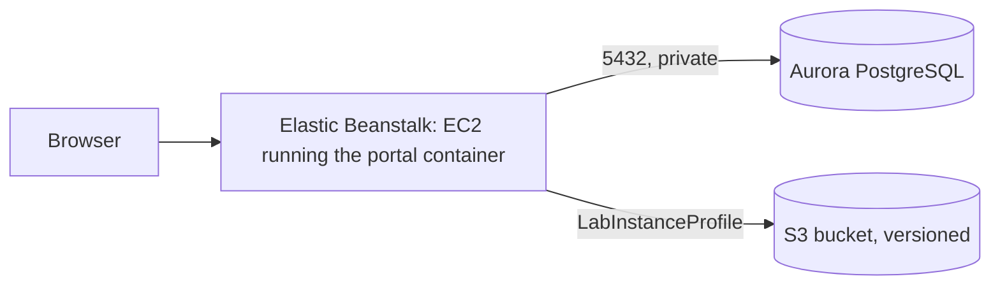

# Deploying to AWS Academy Learner Lab

*Last updated: 2026-11-01*

How to run the portal on AWS with Elastic Beanstalk (the app), Aurora PostgreSQL (data) and S3 (the guide's markdown files). Cognito comes later; until then the portal keeps its own accounts and writes emails to the log.



## Rules of the Learner Lab

- Work in **us-east-1** (N. Virginia). Other regions are blocked.
- You can't create IAM roles. Wherever AWS asks for a role, pick **LabRole**; for EC2 it's **LabInstanceProfile**.
- A session lasts 4 hours. When it ends, EC2 instances stop and start again with the next session. Aurora and S3 keep running and keep costing money: stop Aurora yourself after each work session (see [Saving budget](#saving-budget)).
- Watch the budget shown on the lab page. Aurora costs the most; see [Saving budget](#saving-budget).

Start the lab, wait for the dot to turn green, then click **AWS** to open the console. Check the region in the top-right corner says N. Virginia.

## Tags

Give every resource the same tags, so they can be listed together (Resource Groups & Tag Editor → filter on `Project`). Keys and values are case-sensitive.

| Key | Value |
| --- | --- |
| `Project` | `cloud-dev-portal` |
| `Name` | the resource's own name, e.g. `portal-db-sg` (security groups show it in the Name column) |
| `Environment` | `dev` |

Beanstalk copies its tags to the EC2 instance and the other resources it creates.

## 1. Security groups

EC2 → **Security Groups** → **Create security group**, both in the default VPC:

| Name | Inbound rules | Purpose |
| --- | --- | --- |
| `portal-app-sg` | none | Put on the portal's EC2 instance, so the database can trust it |
| `portal-db-sg` | PostgreSQL (5432), source: `portal-app-sg` | Put on Aurora: only the portal can reach it |

Create `portal-app-sg` first: the rule on `portal-db-sg` points to it.

## 2. S3 bucket for the markdown files

S3 → **Create bucket**:

- **Bucket name:** something unique, e.g. `cloud-dev-portal-docs-<your-student-id>`
- **Block all public access:** on (the default)
- **Bucket Versioning:** **Enable**. Every replaced or removed file stays recoverable.
- **Default encryption:** SSE-S3 (the default)

Write down the name; it becomes `DOCS_BUCKET`.

## 3. Aurora PostgreSQL

RDS → **Create database**:

| Setting | Value |
| --- | --- |
| Creation method | Standard create |
| Engine | **Aurora (PostgreSQL Compatible)**, latest version offered |
| Template | Dev/Test |
| DB cluster identifier | `portal-db` |
| Master username | `portal` |
| Credentials management | **Self managed**, type a password (letters and digits are easiest) and write it down |
| Cluster storage configuration | Aurora Standard |
| Cluster scalability type | **Provisioned**. Learner Lab refuses Aurora Serverless: creation fails with "not authorized to perform rds:CreateDBInstance … explicit deny" |
| DB instance class | Burstable classes → **db.t3.medium** (or db.t4g.medium), the smallest Aurora PostgreSQL offers. It runs, and bills about $2 a day, until you stop it |
| Multi-AZ | Don't create an Aurora Replica |
| VPC | Default VPC |
| Public access | **No** |
| VPC security group | Choose existing: **`portal-db-sg`** (remove `default`) |
| Monitoring | **Turn off Enhanced Monitoring and Performance Insights**. They need an IAM role the lab can't create, and creation fails otherwise |
| Additional configuration → **Initial database name** | **`portal`**. Without it there is no database for the app to use |
| Backup retention | 1 day |
| Deletion protection | Off (so you can delete it at the end of the course) |

Don't use **Easy create / express configuration**: it uses IAM-only database login (the app signs in with a password) and puts the database outside the VPC, and neither can be changed later.

If a failed attempt left a `portal-db` cluster with no instance, delete it before trying again.

Creating the cluster takes 5 to 10 minutes. Then open `portal-db` → **Connectivity & security** and copy the **writer** endpoint (`portal-db.cluster-xxxx.us-east-1.rds.amazonaws.com`). It becomes `DB_HOST`.

## 4. Build the app bundle

Beanstalk builds the [Dockerfile](../Dockerfile) on the instance, so upload the source as a zip. `git archive` packs only committed files, so commit first:

```bash
git archive -o portal.zip HEAD
```

## 5. Elastic Beanstalk

Elastic Beanstalk → **Create application**.

**Step 1: Configure environment**

- Environment tier: **Web server environment**
- Application name: `cloud-dev-portal`
- Platform: **Docker**, branch "Docker running on 64bit Amazon Linux 2023"
- Application code: **Upload your code**, version label `v1`, choose `portal.zip`
- Presets: **Single instance** (cheapest; no load balancer). Choose "High availability" later to show auto scaling.

**Step 2: Configure service access**

- Service role: **Use an existing service role → LabRole**
- EC2 key pair: `vockey` (optional, lets you SSH in)
- EC2 instance profile: **LabInstanceProfile**. This is what lets the app use S3 without keys.

**Step 3: Networking, database and tags**

- VPC: the default VPC; **Public IP address: Activated**; tick one or two subnets
- Database: leave it off. Aurora is separate, not created by Beanstalk.

**Step 4: Instance traffic and scaling**

- EC2 security groups: tick **`portal-app-sg`** (keep the one Beanstalk adds)
- Instance types: **t3.small** only. Building the frontend needs about 2 GB of memory; if the first deploy fails while building, switch to t3.medium.

**Step 5: Updates, monitoring and logging**

- Health reporting: Basic (Enhanced also works with LabRole)
- Managed updates: off
- **Environment properties** (the portal's settings):

| Name | Value |
| --- | --- |
| `ENVIRONMENT` | `staging` (not `production` yet: that requires SMTP and HTTPS, which come with Cognito and CloudFront) |
| `JWT_SECRET_KEY` | 48+ random characters: `python -c "import secrets; print(secrets.token_urlsafe(48))"` |
| `DB_HOST` | the Aurora writer endpoint |
| `DB_NAME` | `portal` |
| `DB_USER` | `portal` |
| `DB_PASSWORD` | the Aurora password |
| `DOCS_BUCKET` | your bucket name |
| `AWS_REGION` | `us-east-1` |
| `SEED_ADMIN_EMAIL` | your email: the first admin |
| `SEED_ADMIN_PASSWORD` | 12+ characters |

**Step 6: Review → Submit.** The first launch takes about 10 minutes (it builds the image). When the environment shows **Ok**, open its URL (`cloud-dev-portal-env.eba-xxxx.us-east-1.elasticbeanstalk.com`) and sign in with the seed admin.

Then add one more property so links in emails point to the portal: `PUBLIC_BASE_URL` = that URL, starting with `http://`.

**Health check:** Configuration → Instance traffic and scaling (with a load balancer: Processes) → set the health check path to `/api/health`.

On every start, the container brings the Aurora tables up to date (`alembic upgrade head`) and loads the checklist standards. To add the four demo systems, connect to the instance (EC2 → the instance → Connect) and run:

```bash
sudo docker exec $(sudo docker ps -q) python -m app.seed --demo
```

## 6. Check it works

1. Open a system → handover guide → attach a `.md` file.
2. S3 → your bucket: the file is at `systems/<id>/<question>/<file>.md`. Replace it in the portal, then turn on **Show versions** in S3 to see both copies.
3. Emails (sign-up verification, password reset) are in the log until Cognito replaces them: Beanstalk → **Logs → Request logs → Last 100 lines**.

## Deploying a new version

```bash
git archive -o portal.zip HEAD
```

Beanstalk → your environment → **Upload and deploy** → choose `portal.zip`, give it a new version label.

## Saving budget

- **Stop Aurora after every work session.** `db.t3.medium` bills about $0.08 an hour whenever it runs, even with the lab session off: left on, it alone uses up a $50 budget in under a month.
  - Finishing: RDS → Databases → select the cluster `portal-db` → **Actions → Stop temporarily**. Stopped, it costs only storage.
  - Starting: **Actions → Start**, and wait about 5 minutes for **Available** before opening the portal (until then it shows database errors).
  - AWS starts a stopped cluster again by itself after 7 days: stop it again if you haven't worked on the project for a week.
  - Some courses stop RDS when the lab session ends; check the lab's Readme, and don't rely on it otherwise.
- Single-instance Beanstalk avoids paying for a load balancer.
- Never create a NAT Gateway: it bills by the hour and isn't needed here.
- At the end of the course: terminate the Beanstalk environment, delete the Aurora cluster (skip the final snapshot), empty and delete the bucket.

## Using the AWS CLI from your computer

Lab page → **AWS Details → AWS CLI: Show** → copy the block into `~/.aws/credentials` (on Windows, `C:\Users\<you>\.aws\credentials`). The keys change every session; copy them again each time.

To run the portal locally against the real bucket, set `DOCS_BUCKET` in `backend/.env`. Aurora isn't reachable from your computer (no public access), so local runs keep SQLite.

## When something goes wrong

| Symptom | Likely cause |
| --- | --- |
| Environment "Severe", log shows `connection timeout` to the database | `portal-app-sg` isn't on the instance, or `portal-db-sg` doesn't allow 5432 from it |
| `database "portal" does not exist` | Initial database name was left empty when creating Aurora. Recreate the cluster, or create the database by hand |
| `password authentication failed` | `DB_USER` / `DB_PASSWORD` don't match the Aurora master user |
| `AccessDenied` from S3 | Instance profile isn't LabInstanceProfile, or `DOCS_BUCKET` is misspelled |
| First deploy fails during `npm run build` | Not enough memory: use t3.medium |
| Aurora creation fails mentioning a monitoring role | Enhanced Monitoring is on: turn it off |
| Aurora creation fails: `not authorized to perform rds:CreateDBInstance` … `explicit deny` | Serverless (or a large instance class) chosen: use Provisioned, db.t3.medium |
| Portal shows database errors at the start of a session | Aurora is stopped: start it and wait for Available |
| Everything stopped after the lab timed out | Normal: start the lab again and EC2 comes back in a few minutes |

Where to read logs: Beanstalk → **Logs → Request logs → Full logs**. The app's output is under `var/log/eb-docker/containers/eb-current-app/`.
