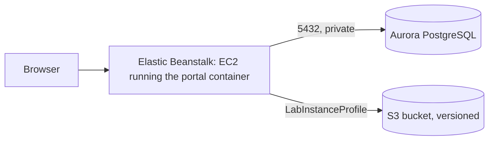
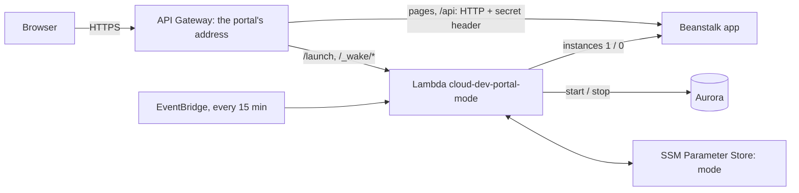

# Deploying to AWS Academy Learner Lab

*Last updated: 2026-11-01*

How to run the portal on AWS with Elastic Beanstalk (the app), Aurora PostgreSQL (data) and S3 (the guide's markdown files). Build it step by step to learn each piece, or all at once with [one CloudFormation stack](#build-everything-with-one-stack). Cognito comes later; until then the portal keeps its own accounts and writes emails to the log.



## Rules of the Learner Lab

- Work in **us-east-1** (N. Virginia). Other regions are blocked.
- You can't create IAM roles. Wherever AWS asks for a role, pick **LabRole**; for EC2 it's **LabInstanceProfile**.
- A session lasts 4 hours, and its end needs some care: see [When a lab session ends](#when-a-lab-session-ends).
- Watch the budget shown on the lab page. Aurora costs the most; see [Saving budget](#saving-budget).

Start the lab, wait for the dot to turn green, then click **AWS** to open the console. Check the region in the top-right corner says N. Virginia.

## When a lab session ends

A session lasts 4 hours. What happens when it ends matters more than it looks:

- **Your keys and console tabs stop working.** Every call fails with `explicit deny … voc-cancel-cred`.
- **The instance is lost and replaced, and the replacement can be left without the app.** We saw this happen: the session ended, Beanstalk's instance group launched a new instance, and that instance got `403` from S3 every hour, so it never installed the app. It kept running, and billing, with nothing on it. It didn't recover by itself after the lab restarted.
- **Beanstalk still shows Green,** because Basic health only checks that the instance is alive. Check the portal's address, not the colour.
- **Aurora keeps running and billing.**
- **`LabRole` appears to be blocked too** while the session is off, as those 403s suggest. So don't count on anything that uses it, such as the midnight rule and the idle check, to run with no session open. (Not tested directly for the Lambda function.)

**Before the session ends** (the lab page shows the time left):

- Stop Aurora: RDS → `portal-db` → **Actions → Stop temporarily**.
- Once [hibernate mode](#active-and-hibernate-modes) is set up, run the `hibernate` switch instead. It stops Aurora and sets the instance count to 0, so no replacement is launched.

**After starting the lab again:**

1. Wait for the green dot, then open the console **from the lab page**. A tab left open from the last session keeps showing `voc-cancel-cred` errors.
2. Copy the new keys into `~/.aws/credentials` if you use the CLI ([how](#using-the-aws-cli-from-your-computer)).
3. Start Aurora if it's stopped, and wait for **Available**.
4. Open the portal's address. If it doesn't answer (connection refused or reset) while Beanstalk shows Green, the instance is stuck. **Redeploying doesn't help:** the deploy reports success in seconds, because the instance never finished its first setup. **Replace the instance:** EC2 → Instances → select the environment's instance → **Instance state → Terminate**. It holds no data (that's in Aurora and S3). The group launches a new one, which installs the app from scratch in about 5 minutes. Or from the terminal:

```bash
aws autoscaling terminate-instance-in-auto-scaling-group --instance-id <instance id> --no-should-decrement-desired-capacity
```

   If Session Manager can't reach a running instance after a restart, its agent may have failed to register during boot: **Reboot** the instance, or replace it the same way.

## Tags

Give every resource the same tags, so they can be listed together (Resource Groups & Tag Editor → filter on `Project`). Keys and values are case-sensitive.

| Key | Value |
| --- | --- |
| `Project` | `cloud-dev-portal` |
| `Name` | the resource's own name, e.g. `portal-db-sg` (security groups show it in the Name column) |
| `Environment` | `dev` |

Beanstalk copies its tags to the EC2 instance and the other resources it creates. Leave out `Name` there: Beanstalk reserves it and sets it to the environment's name ("Tag key 'Name' is reserved").

## 1. Security groups

EC2 → **Security Groups** → **Create security group**, both in the default VPC:

| Name | Inbound rules | Purpose |
| --- | --- | --- |
| `portal-app-sg` | none | Put on the portal's EC2 instance, so the database can trust it |
| `portal-db-sg` | PostgreSQL (5432), source: `portal-app-sg` | Put on Aurora: only the portal can reach it |

Create `portal-app-sg` first: the rule on `portal-db-sg` points to it.

## 2. S3 bucket for the markdown files

S3 → **Create bucket**:

- **Bucket name:** something unique, e.g. `cloud-dev-portal-docs-<your-student-id>`
- **Block all public access:** on (the default)
- **Bucket Versioning:** **Enable**. Every replaced or removed file stays recoverable.
- **Default encryption:** SSE-S3 (the default)

Write down the name; it becomes `DOCS_BUCKET`.

## 3. Aurora PostgreSQL

RDS → **Create database**:

| Setting | Value |
| --- | --- |
| Creation method | Standard create |
| Engine | **Aurora (PostgreSQL Compatible)**, latest version offered |
| Template | Dev/Test |
| DB cluster identifier | `portal-db` |
| Master username | `portal` |
| Credentials management | **Self managed**, type a password (letters and digits are easiest) and write it down |
| Cluster storage configuration | Aurora Standard |
| Cluster scalability type | **Provisioned**. Learner Lab refuses Aurora Serverless: creation fails with "not authorized to perform rds:CreateDBInstance … explicit deny" |
| DB instance class | Burstable classes → **db.t3.medium** (or db.t4g.medium), the smallest Aurora PostgreSQL offers. It runs, and bills about $2 a day, until you stop it |
| Multi-AZ | Don't create an Aurora Replica |
| VPC | Default VPC |
| Public access | **No** |
| VPC security group | Choose existing: **`portal-db-sg`** (remove `default`) |
| Monitoring | **Turn off Enhanced Monitoring and Performance Insights**. They need an IAM role the lab can't create, and creation fails otherwise |
| Additional configuration → **Initial database name** | **`portal`**. Without it there is no database for the app to use |
| Backup retention | 1 day |
| Deletion protection | Off (so you can delete it at the end of the course) |

Don't use **Easy create / express configuration**: it uses IAM-only database login (the app signs in with a password) and puts the database outside the VPC, and neither can be changed later.

If a failed attempt left a `portal-db` cluster with no instance, delete it before trying again.

Creating the cluster takes 5 to 10 minutes. Then open `portal-db` → **Connectivity & security** and copy the **writer** endpoint (`portal-db.cluster-xxxx.us-east-1.rds.amazonaws.com`). It becomes `DB_HOST`.

## 4. Build the app bundle

Beanstalk builds the [Dockerfile](../Dockerfile) on the instance, so upload the source as a zip. `git archive` packs only committed files, so commit first:

```bash
git archive -o portal.zip HEAD
```

## 5. Elastic Beanstalk

Elastic Beanstalk → **Create application**.

**Step 1: Configure environment**

- Environment tier: **Web server environment**
- Application name: `cloud-dev-portal`
- Platform: **Docker**, branch "Docker running on 64bit Amazon Linux 2023"
- Application code: **Upload your code**, version label `v1`, choose `portal.zip`
- Presets: **Single instance** (cheapest; no load balancer). Choose "High availability" later to show auto scaling.

**Step 2: Configure service access**

- Service role: **Use an existing service role → LabRole**
- EC2 key pair: **leave empty**. A key pair makes Beanstalk open SSH (port 22) to the whole internet; you get a shell through Session Manager instead, which needs no open port (step 7)
- EC2 instance profile: **LabInstanceProfile**. This is what lets the app use S3 without keys.

**Step 3: Networking, database and tags**

- VPC: the default VPC; **Public IP address: Activated**; tick one or two subnets
- Database: leave it off. Aurora is separate, not created by Beanstalk.

**Step 4: Instance traffic and scaling**

- EC2 security groups: tick **`portal-app-sg`** (keep the one Beanstalk adds)
- Instance types: **t3.small** only. Building the frontend needs about 2 GB of memory; if the first deploy fails while building, switch to t3.medium.

**Step 5: Updates, monitoring and logging**

- Health reporting: Basic (Enhanced also works with LabRole)
- Managed updates: off
- **Environment properties** (the portal's settings):

| Name | Value |
| --- | --- |
| `ENVIRONMENT` | `staging` (not `production` yet: that requires SMTP and HTTPS) |
| `JWT_SECRET_KEY` | 48+ random characters: `python -c "import secrets; print(secrets.token_urlsafe(48))"` |
| `DB_HOST` | the Aurora writer endpoint |
| `DB_NAME` | `portal` |
| `DB_USER` | `portal` |
| `DB_PASSWORD` | the Aurora password |
| `DOCS_BUCKET` | your bucket name |
| `AWS_REGION` | `us-east-1` |
| `SEED_ADMIN_EMAIL` | your email: the first admin |
| `SEED_ADMIN_PASSWORD` | 12+ characters |

> These start in plain text so the first deploy has nothing extra to go wrong: anyone who can open the environment's configuration can read `DB_PASSWORD` and `JWT_SECRET_KEY`, and the app signs in as Aurora's all-powerful master user. [Step 7](#7-security-hardening) fixes both once the portal works.

**Step 6: Review → Submit.** The first launch takes about 10 minutes (it builds the image). When the environment shows **Ok**, open its URL (`cloud-dev-portal-env.eba-xxxx.us-east-1.elasticbeanstalk.com`) and sign in with the seed admin.

Then add one more property so links in emails point to the portal: `PUBLIC_BASE_URL` = that URL, starting with `http://`.

**Health check:** Configuration → Instance traffic and scaling (with a load balancer: Processes) → set the health check path to `/api/health`.

On every start, the container brings the Aurora tables up to date (`alembic upgrade head`) and loads the checklist standards. To add the four demo systems, open a shell on the instance (EC2 → the instance → **Connect** → **Session Manager** → **Connect**) and run:

```bash
sudo docker exec $(sudo docker ps -q) python -m app.seed --demo
```

## 6. Check it works

1. Open a system → handover guide → attach a `.md` file.
2. S3 → your bucket: the file is at `systems/<id>/<question>/<file>.md`. Replace it in the portal, then turn on **Show versions** in S3 to see both copies.
3. Emails (sign-up verification, password reset) are in the log until Cognito replaces them: Beanstalk → **Logs → Request logs → Last 100 lines**.

## 7. Security hardening

The portal works; now take away everything it doesn't need. Two principles:

- **Least privilege:** each part gets only the access its job needs, so a mistake or a break-in in one part can't reach further.
- **No standing authority:** secrets and admin powers aren't left lying around (in plain text, in settings, on open ports) once their job is done.

| # | Change | Before | After |
| --- | --- | --- | --- |
| 7a | No SSH | Port 22 open to the internet | Shell through Session Manager only |
| 7b | The app's own database user | App signs in as Aurora's master user | `portal_app`, which owns only its own database |
| 7c | Secrets in SSM | Passwords in plain text in Beanstalk | Encrypted SecureStrings, linked by name |
| 7d | No seed admin password | Admin password kept in the configuration | Removed after the first sign-in |
| 7e | S3 over HTTPS only | Bucket answers plain HTTP | Plain HTTP refused |
| 7f | HTTPS for the browser | `http://` Beanstalk address | `https://` API Gateway address; the Beanstalk address refuses visitors |

### 7a. Close SSH

1. Beanstalk → your environment → **Configuration** → **Service access** → **Edit** → EC2 key pair: **remove it** (choose none) → **Apply**. Beanstalk replaces the instance (a few minutes) and removes its SSH rule.
2. EC2 → **Security Groups** → the group whose name starts with `awseb-` and ends with your environment's ID: **Inbound rules** show only **HTTP 80**. If a rule for port 22 is still there, delete it.

**A shell without SSH:** EC2 → the instance → **Connect** → **Session Manager** → **Connect**. It goes through the Systems Manager agent on the instance (LabInstanceProfile allows it), with no open port and no key file to lose.

### 7b. The app's own database user

The app signs in as `portal`, Aurora's master user, which may do anything to every database on the server. Give it a user that owns only its own database:

1. Open a shell with Session Manager (7a) and run:

```bash
sudo docker exec $(sudo docker ps -q) python -m app.app_db_user --param /cloud-dev-portal/db-password
```

   It uses the app's current (master) settings to create the user **`portal_app`** and the database **`portal`**, which only `portal_app` may connect to. It creates the tables there as `portal_app`, copies every row across, and stores `portal_app`'s new password in SSM Parameter Store as an encrypted SecureString, without ever printing it. The output ends with `Password stored in SSM as /cloud-dev-portal/db-password (SecureString).` The old tables stay where they were, untouched.
2. Don't apply anything yet: 7c links the new password.

From now on the master password is needed by nobody but you, for running steps like this one. Keep it in a password manager, not in a file.

### 7c. Secrets into SSM Parameter Store

1. Systems Manager → **Parameter Store** → **Create parameter**: name **`/cloud-dev-portal/jwt-secret-key`**, type **SecureString** (KMS key: the default `alias/aws/ssm`), value: a new key from

```bash
python -c "import secrets; print(secrets.token_urlsafe(48))"
```

2. Beanstalk → **Configuration** → **Updates, monitoring, and logging** → **Edit** → Environment properties. Change these rows:

| Name | Source | Value |
| --- | --- | --- |
| `DB_USER` | Plain text | `portal_app` |
| `DB_NAME` | Plain text | `portal` |
| `DB_PASSWORD` | **SSM Parameter Store** | `arn:aws:ssm:us-east-1:<account id>:parameter/cloud-dev-portal/db-password` |
| `JWT_SECRET_KEY` | **SSM Parameter Store** | `arn:aws:ssm:us-east-1:<account id>:parameter/cloud-dev-portal/jwt-secret-key` |

   Your account ID is the 12-digit number in the top-right account menu. Beanstalk reads the values on the instance at each deploy, through the instance profile, so they never appear in the configuration.

### 7d. Remove the seed admin password

The admin account exists since the first start; the app needs `SEED_ADMIN_PASSWORD` only to create it. In the same properties form, **Remove** the `SEED_ADMIN_PASSWORD` row (keep `SEED_ADMIN_EMAIL`: it's the contact shown on the sign-in page). Keep the password in a password manager, and delete it from any local file such as `.env.beanstalk`.

Now **Apply** 7b–7d together: one restart. The new session key signs everyone out once.

**Checkpoint.** The portal works and you can sign in, with your systems still there. The environment's properties show no password in plain text.

### 7e. S3 over HTTPS only

S3 → your bucket → **Permissions** → **Bucket policy** → **Edit**: paste [infra/iam/docs-bucket-policy.json](../infra/iam/docs-bucket-policy.json) with `BUCKET_NAME` replaced by your bucket's name (twice) → **Save**. Any request that isn't encrypted is now refused; the app already uses HTTPS.

### 7f. HTTPS for the browser

The portal's own address is plain `http://`: passwords and session cookies would cross the network unencrypted. HTTPS comes with the API Gateway built in [Active and hibernate modes](#active-and-hibernate-modes): its `https://` address passes the portal's pages to Beanstalk, and the last step there locks the Beanstalk address so visitors can't go around it.

### What the lab doesn't allow

- **Least-privilege IAM roles.** Learner Lab can't create roles, so the app and the mode function run as `LabRole`, which may do much more than they need. [infra/iam/](../infra/iam/) has the exact policies each should have in a real account.
- **Encryption all the way to the app.** The browser–AWS leg is HTTPS; API Gateway → Beanstalk stays HTTP. Closing it needs a private VPC link, which needs a load balancer and a certificate for a domain you own, neither available here.

## Build everything with one stack

Steps 1 to 7 and the hibernate system, built by hand, take most of a day. [infra/full-stack.yaml](../infra/full-stack.yaml) describes all of it in one file: upload it, and CloudFormation builds the whole portal from nothing in about 25 minutes. **Delete the stack and everything it made is gone**, data included. So you can tear it down after each practice and build it again, paying only while it exists.

Use **either** this **or** the hand-built version, not both: they use the same names (`portal-db`, `cloud-dev`, `portal-app-sg`…), so anything left from a hand-built setup makes the stack fail.

**What it builds:** the two security groups, the private and versioned S3 bucket with its HTTPS-only policy, Aurora, generated secrets, the Beanstalk application and environment (no key pair, so no SSH), the Lambda function, the `mode` parameter, both EventBridge rules, and the API Gateway HTTPS address.

**What differs from the hand-built version, and why:**

| | By hand | This stack | Why |
| --- | --- | --- | --- |
| Secrets | SSM SecureStrings | **Secrets Manager** | CloudFormation can't create SecureStrings, but it can generate secrets here. Nobody ever types or sees them |
| The app's database user | You run a script once | **The container creates it on start** | Nobody is there to run a script. The master password stays in its secret; the app gets only that secret's ARN |
| Seed admin password | Removed after first sign-in | **Stays linked, in its secret** | Removing it would make the running environment differ from the template. The app ignores it once the account exists |
| Code | You upload zips | **Fetched from GitHub** | A small function downloads the repository, which must be public, when the stack is created |

### Create it

1. Start the lab and open the console from the lab page, with at least **an hour** left in the session (the lab page shows the time).
2. CloudFormation → **Create stack** → **With new resources (standard)** → *Choose an existing template* → **Upload a template file** → [infra/full-stack.yaml](../infra/full-stack.yaml) → **Next**.
3. Stack name: **`gargantua`**. Parameters:
   - `AdminEmail`: the email you'll sign in with. Required.
   - `GitHubRepo`: your copy of the repository, if you forked it. It must be public.
   - `DomainPrefix`: if `cloud-dev-portal` is taken, add your student ID.
   - Leave the rest as they are.
4. **Next** → Tags: `Project = cloud-dev-portal`, `Environment = dev`. Permissions: leave the IAM role empty. Stack failure options: **Delete all newly created resources**, so a failed attempt leaves nothing behind → **Next** → **Submit**.
5. Watch the **Events** tab, with the newest at the top. Aurora takes about 10 minutes and Beanstalk about 10 more. The stack finishes with **CREATE_COMPLETE**.

**Checkpoint.**

1. **Outputs** → open `PortalUrl`: the Gargantua sign-in page over HTTPS. If it shows `Service Unavailable`, the app is still starting: try again in a few minutes.
2. Secrets Manager → open the secret named in `AdminPasswordSecret` → **Retrieve secret value**. Sign in with `AdminEmail` and that password.
3. Open a system's handover guide and attach a `.md` file: it appears in the bucket under `systems/`.
4. Lambda → `cloud-dev-portal-mode` → **Test** tab: save and run the [switch events](#switching). `{"action": "status"}` should show `"ready": true`.

### Reset: delete it

CloudFormation → `gargantua` → **Delete**. It takes 10 to 20 minutes, removes everything above, and empties the bucket first. **All portal data is lost**, by design: there's no final snapshot. Check that the stack disappears from the list; if it shows **DELETE_FAILED**, open **Events** for the reason and press **Delete** again.

CloudFormation doesn't remove these two things, which cost next to nothing: Beanstalk's own bucket `elasticbeanstalk-us-east-1-<account id>`, and the parameter `/cloud-dev-portal/woken-at`, which the function creates by itself.

Delete the stack before the lab session ends if you're done, since Aurora bills about $2 a day while it exists ([more](#when-a-lab-session-ends)).

## Deploying a new version

```bash
git archive -o portal.zip HEAD
```

Beanstalk → your environment → **Upload and deploy** → choose `portal.zip`, give it a new version label.

## Saving budget

- **Use hibernate mode** ([below](#active-and-hibernate-modes)): the portal then sleeps by itself when nobody uses it. Until it is set up, stop Aurora by hand as described next.
- **Stop Aurora after every work session.** `db.t3.medium` bills about $0.08 an hour whenever it runs, even with the lab session off: left on, it alone uses up a $50 budget in under a month.
  - Finishing: RDS → Databases → select the cluster `portal-db` → **Actions → Stop temporarily**. Stopped, it costs only storage.
  - Starting: **Actions → Start**, and wait about 5 minutes for **Available** before opening the portal (until then it shows database errors).
  - AWS starts a stopped cluster again by itself after 7 days: stop it again if you haven't worked on the project for a week.
  - Some courses stop RDS when the lab session ends; check the lab's Readme, and don't rely on it otherwise.
- Single-instance Beanstalk avoids paying for a load balancer.
- Never create a NAT Gateway: it bills by the hour and isn't needed here.
- At the end of the course: terminate the Beanstalk environment, delete the Aurora cluster (skip the final snapshot), empty and delete the bucket.

## Active and hibernate modes

Two modes, switched with one click:

| | **Active** (presentation days) | **Hibernate** (development days) |
| --- | --- | --- |
| Aurora and the Beanstalk instance | Always on | Asleep when nobody uses the portal |
| Goes to sleep | When you switch to hibernate, or at midnight at the latest (then it's in hibernate) | After 30 minutes without visitors (checked every 15 minutes), and at midnight |
| Opening the site | Instant | Through the **launcher link** (`…/launch`): while asleep it shows a "waking up" page, and forwards to the portal after 5–10 minutes |
| Cost | About $2.50 a day | Storage only while asleep |



- **API Gateway is the portal's address** (`https://…execute-api…`). It passes the portal's pages to Beanstalk and adds a secret header; the app refuses requests without it, so the HTTPS address is the only way in ([7f](#7f-https-for-the-browser)).
- **The launcher link** is that address plus `/launch`: share it. While the portal is awake it forwards straight to the portal; while it sleeps it shows the waking-up page.
- **The waking-up page** asks the Lambda function to start Aurora and the Beanstalk instance, checks every 10 seconds, and forwards to the portal when both are up.
- **EventBridge** runs the function every 15 minutes. In hibernate mode it asks the portal how long it has been idle (`/api/health` reports it) and puts it to sleep after 30 minutes. In active mode it only makes sure everything is still on.
- **At midnight**, a second EventBridge rule switches to hibernate and stops everything, whatever the mode: a safety net in case active mode was left on after a presentation. It may not run while no lab session is open ([why](#when-a-lab-session-ends)), so before a session ends, run the `hibernate` switch yourself.
- **The mode** is kept in SSM Parameter Store, `/cloud-dev-portal/mode`.
- The code: [infra/portal_mode/](../infra/portal_mode/) (the function and the waking-up page; [infra/portal_mode.zip](../infra/portal_mode.zip) is the same, ready to upload, rebuilt with `python scripts/build_lambda_zip.py`), [infra/sleep-wake.yaml](../infra/sleep-wake.yaml) (CloudFormation), [scripts/portal_mode.py](../scripts/portal_mode.py).

> **Why not CloudFront?** CloudFront could give HTTPS and show the waking-up page in place of *any* page of a sleeping portal. AWS Academy Learner Lab doesn't allow CloudFront: every call is refused (`not authorized to perform: cloudfront:ListDistributions … because no identity-based policy allows`). API Gateway, which the lab allows, does both jobs here, with one difference: only `/launch` wakes the portal, so share that link.

### Two ways to set it up

The same four pieces can be built two ways. Both give the same result; pick one.

- **[Option A: by hand in the console](#option-a-set-it-up-by-hand-in-the-console)**: about an hour. You create each piece yourself and see what it does and how they connect. Best for learning.
- **[Option B: with CloudFormation](#option-b-set-it-up-with-cloudformation)**: about 15 minutes, also all in the web console. One template ([infra/sleep-wake.yaml](../infra/sleep-wake.yaml)) creates all of it and deletes it again in one step. Infrastructure as code.

Before either: the Beanstalk environment works (step 6), and you have its **name** from its page, e.g. `cloud-dev-portal-env`. The steps below write it as `<environment name>`.

### Option A: set it up by hand in the console

You build the pieces in the order they depend on each other: the function first, since everything else calls it.

| Step | Piece | Its job |
| --- | --- | --- |
| A1 | Lambda function | Does the work: switches modes, starts and stops Aurora and the instance, answers the launcher link |
| A2 | SSM parameter | Remembers the current mode between runs |
| A3 | EventBridge rules | Run the function every 15 minutes to put an idle portal to sleep, and at midnight to stop everything |
| A4 | API Gateway | The portal's HTTPS address: pages to the app, `/launch` and `/_wake/*` to the function |
| A5 | Finishing | Locks the app to the HTTPS address; saves the switches; tests the whole system |

#### A1. Lambda function

The function's code is ready in [infra/portal_mode.zip](../infra/portal_mode.zip): `handler.py` (the function) and `wake.html` (the waking-up page). Download it from the repository.

1. Lambda → **Create function** → **Author from scratch**.
   - Function name: **`cloud-dev-portal-mode`**
   - Runtime: **Python 3.12**
   - Permissions → *Change default execution role* → **Use an existing role** → **LabRole**
   - **Create function**.
2. **Code** tab → **Upload from** → **.zip file** → choose `portal_mode.zip` → **Save**. The file list on the left now shows `handler.py` and `wake.html`.
3. **Code** tab → **Runtime settings** → **Edit** → Handler: **`handler.lambda_handler`** → **Save**.
4. **Configuration** → **General configuration** → **Edit** → Timeout: **30 sec** → **Save**. (Starting Aurora and reading the app's state takes longer than the default 3 seconds.)
5. **Configuration** → **Environment variables** → **Edit** → add:

| Key | Value | Meaning |
| --- | --- | --- |
| `DB_CLUSTER_ID` | `portal-db` | The Aurora cluster to start and stop |
| `EB_ENVIRONMENT` | `<environment name>` | The Beanstalk environment whose instance count changes |
| `PARAM_PREFIX` | `/cloud-dev-portal` | Where A2's parameter lives |
| `IDLE_MINUTES` | `30` | In hibernate mode, sleep after this many minutes without visitors |

6. Add the tags `Project = cloud-dev-portal` and `Environment = dev` (**Configuration** → **Tags**).

**Checkpoint.** **Test** tab → Create new event, name `status`, Event JSON `{"action": "status"}` → **Test**. The result shows the portal's state:

```json
{"mode": "hibernate", "database": "available", "app_instances": 1, "app_answers": true, "idle_minutes": 2, "ready": true}
```

`"mode"` says `hibernate` until A2 exists; that's expected. If the result is an `AccessDenied` error instead, LabRole doesn't allow that action in your course: read the message for the action's name, see [Things to know](#things-to-know), and stop here.

#### A2. SSM parameter

Systems Manager → **Parameter Store** → **Create parameter**:

- Name: **`/cloud-dev-portal/mode`**
- Tier: Standard · Type: **String** · Data type: text
- Value: **`active`**. Start in active, so nothing goes to sleep while you build the rest.
- Tags: `Project = cloud-dev-portal`, `Environment = dev`

**Checkpoint.** Run the `status` test event again: `"mode"` is now `active`.

#### A3. EventBridge rules

EventBridge works as the system's clock: a **rule** calls a target (the function) on a schedule, with a message you choose. No code: you fill in a form. You create two rules.

**A3a. The idle check, every 15 minutes.** EventBridge → **Rules** → **Create rule**:

1. Name: **`cloud-dev-portal-tick`**. Event bus: default. Rule type: **Schedule**.
   If the console suggests **EventBridge Scheduler**, choose **Continue in EventBridge rules** instead: Scheduler needs an IAM role of its own, which Learner Lab can't create, while a rule calls Lambda directly.
2. Schedule pattern: **A schedule that runs at a regular rate** → **15 minutes**.
3. Target: **AWS service** → **Lambda function** → **`cloud-dev-portal-mode`**.
   - **Additional settings** → Configure target input: **Constant (JSON text)** → `{"action": "tick"}`
4. Tags: `Project = cloud-dev-portal`, `Environment = dev` → **Create rule**.

**A3b. The midnight shutdown.** Create a second rule the same way, with:

- Name: **`cloud-dev-portal-nightly-stop`**
- Schedule pattern: **A fine-grained schedule (cron expression)** → `0 17 * * ? *`
- Target: the same function. Target input: **Constant (JSON text)** → `{"mode": "hibernate"}`

This is the same message as the `hibernate` switch: every night it sets the mode to hibernate and stops the instance and Aurora at once, whatever the mode was and whether anyone is using the portal.

Rule schedules are in **UTC**: `0 17 * * ? *` means 17:00 UTC every day, which is **midnight in Thailand** (UTC+7). For another time zone, subtract its offset from midnight (e.g. UTC+9: `0 15 * * ? *`).

**Checkpoint.** After 15 minutes, CloudWatch → **Log groups** → `/aws/lambda/cloud-dev-portal-mode` has a new log stream: the idle check ran the function. (While everything is on in active mode, it changes nothing.) To try the midnight rule without waiting, run the `hibernate` test event in A5: it sends the same message.

#### A4. API Gateway

The API becomes the portal's front door: two routes go to the function, everything else to the app.

1. **A secret for the app.** API Gateway will add it to every request it passes on, and the app will refuse requests without it, so nobody can go around HTTPS. Make one:

```bash
python -c "import secrets; print(secrets.token_urlsafe(48))"
```

   Systems Manager → Parameter Store → **Create parameter**: name **`/cloud-dev-portal/origin-verify-secret`**, type **SecureString**, value: the secret.
2. API Gateway → **HTTP API** → **Build**:
   - Integrations: **Add integration** → **Lambda** → `cloud-dev-portal-mode`. API name: **`cloud-dev-portal-wake`** → **Next**.
   - Routes: **`ANY /launch`** and **`ANY /_wake/{proxy+}`**, both to the Lambda integration → **Next**.
   - Stages: **`$default`**, **Auto-deploy** on → **Next** → **Create**.
3. **Routes** → **Create**: **`ANY /{proxy+}`**. Select it → **Attach integration** → **Create and attach an integration**: type **HTTP URI**, method **ANY**, URL **`http://<environment domain>/{proxy}`** (e.g. `http://cloud-dev-portal.us-east-1.elasticbeanstalk.com/{proxy}`).
4. **Routes** → **Create**: **`ANY /`**, attached the same way to a new HTTP URI integration with URL **`http://<environment domain>/`**.
5. **Integrations** → each of the two HTTP URI integrations → **Parameter mapping** → **Create parameter mapping**: mapping type **All incoming requests**; parameter **`header.x-origin-verify`**, modification **Overwrite**, value: the secret from 1. ("Overwrite" also replaces any such header a visitor sends.)
6. **Protect** → **Throttling**: the `$default` stage's default: rate **50**, burst **100** (a page load fetches about 20 files). Then **route-level** throttling for `ANY /launch` and `ANY /_wake/{proxy+}`: rate **5**, burst **10**: those can start servers, so anyone with the link gets only a little.
7. Copy the API's **Invoke URL**, e.g. `https://abc123defg.execute-api.us-east-1.amazonaws.com`: the **portal's address**. The **launcher link** is that plus `/launch`.

**Checkpoint.** Open the Invoke URL: the portal's sign-in page, with `https://` and the API's address in the address bar. Open the launcher link: since the portal is awake, it forwards to the same page.

#### A5. Finishing

1. **Lock the app to the HTTPS address.** Beanstalk → **Configuration** → **Updates, monitoring, and logging** → **Edit** → Environment properties: add

| Name | Source | Value |
| --- | --- | --- |
| `ORIGIN_VERIFY_SECRET` | **SSM Parameter Store** | `arn:aws:ssm:us-east-1:<account id>:parameter/cloud-dev-portal/origin-verify-secret` |
| `COOKIE_SECURE` | Plain text | `true` (sign-in cookies are sent over HTTPS only) |
| `PUBLIC_BASE_URL` | Plain text | the Invoke URL (links in emails) |

   → **Apply**. **Checkpoint:** the Beanstalk address now answers "เปิดพอร์ทัลผ่านที่อยู่ HTTPS ของพอร์ทัล" (open the portal through its HTTPS address), while the Invoke URL works and you can sign in there.
2. Lambda → `cloud-dev-portal-mode` → **Test** tab: save three more test events. These are your switches.

| Event name | Event JSON |
| --- | --- |
| `active` | `{"mode": "active"}` |
| `hibernate` | `{"mode": "hibernate"}` |
| `wake` | `{"action": "wake"}` |

**Checkpoint: the whole system.**

1. Run the **`hibernate`** event. The result shows `"app_instances": 0`.
2. Wait until RDS shows `portal-db` as **Stopped** (about 5 minutes) and EC2 shows no running instance for the environment.
3. Open the launcher link (`…/launch`): the waking-up page appears, its two dots turn orange, then green after 5 to 10 minutes, and it forwards to the portal by itself.
4. Leave it unused: within 45 minutes (30 idle minutes plus up to 15 until the next tick) Aurora stops again.

### Option B: set it up with CloudFormation

A **template** ([infra/sleep-wake.yaml](../infra/sleep-wake.yaml)) describes every piece of Option A as code. CloudFormation reads it and creates them all as one **stack**, `cloud-dev-portal-modes`, which it can later update or delete in one step. It doesn't touch the stacks already listed there: `awseb-…` is the one Beanstalk made for your environment, the other is Learner Lab's own; leave both alone.

All in the web console:

1. **Upload the function's code.** S3 → your docs bucket → **Create folder** `deploy` → open it → **Upload** [infra/portal_mode.zip](../infra/portal_mode.zip). It's now at `deploy/portal_mode.zip`.
2. **Create the secret** `/cloud-dev-portal/origin-verify-secret` as in A4 step 1.
3. **Create the stack.** CloudFormation → **Create stack** → **With new resources (standard)** → *Choose an existing template* → **Upload a template file** → choose `infra/sleep-wake.yaml` → **Next**.
4. Stack name: **`cloud-dev-portal-modes`**. Parameters:

| Parameter | Value |
| --- | --- |
| `CodeBucket` | your docs bucket's name |
| `CodeKey` | `deploy/portal_mode.zip` (the default) |
| `EnvironmentName` | `<environment name>` |
| `EnvironmentCname` | `<environment domain>` (without `http://`) |
| `OriginVerifySecret` | the secret from step 2 (copy it from Parameter Store → the parameter → **Show decrypted value**). The template marks it *NoEcho*, so CloudFormation never shows it again |
| `NightlyStopSchedule` | `cron(0 17 * * ? *)`, midnight in Thailand; for another time zone, midnight in UTC terms |
| `DbClusterId`, `IdleMinutes`, `InitialMode` | leave the defaults |

5. **Next** → Tags: `Project = cloud-dev-portal`, `Environment = dev` (CloudFormation copies them to everything it creates). Permissions: leave the IAM role empty → **Next** → **Submit**.
6. Watch the **Events** tab: each resource appears as it's created. After a minute or two the stack shows **CREATE_COMPLETE**. **Outputs** shows `PortalUrl`, the portal's HTTPS address, and `LauncherUrl`, the link to share. The **Resources** tab lists all 16 pieces with links to each.
7. Lock the app to the HTTPS address as in A5 step 1, with `PortalUrl` as `PUBLIC_BASE_URL`.
8. Lambda → `cloud-dev-portal-mode` → **Test** tab: save three test events:

| Event name | Event JSON |
| --- | --- |
| `active` | `{"mode": "active"}` |
| `hibernate` | `{"mode": "hibernate"}` |
| `wake` | `{"action": "wake"}` |

**Changing it later.** Edit the template, then the stack → **Update** → **Replace current template** → upload it. CloudFormation shows what it will change, and changes only that. For a new version of the function, upload the zip under a new name (e.g. `deploy/portal_mode-2.zip`) and update the stack with that `CodeKey`: with the same name, CloudFormation sees no change.

**From the terminal** instead, the same in two commands:

```bash
aws s3 cp infra/portal_mode.zip s3://<your docs bucket>/deploy/portal_mode.zip
```

```bash
aws cloudformation deploy --template-file infra/sleep-wake.yaml --stack-name cloud-dev-portal-modes --parameter-overrides CodeBucket=<your docs bucket> EnvironmentName=<environment name> EnvironmentCname=<environment domain> OriginVerifySecret=$(aws ssm get-parameter --name /cloud-dev-portal/origin-verify-secret --with-decryption --query Parameter.Value --output text)
```

### Switching

- **In the console:** Lambda → `cloud-dev-portal-mode` → Test → choose the event → **Test**. The result shows the state (`database`, `app_instances`, `ready`).
- **From the terminal:** `python scripts/portal_mode.py active` (or `hibernate`, `wake`, `status`).
- **Presentation day:** switch to `active` at least 15 minutes before you start; back to `hibernate` afterwards. If you forget, the midnight rule does it for you, provided a lab session is still open.
- **Development day:** stay in `hibernate`. Open the launcher link and wait on the waking-up page, or run `wake` while you get ready.

### Things to know

- While asleep, Beanstalk shows the environment as **Severe** or **No data**: expected, it has no instance. The portal's pages don't answer then (API Gateway shows `Service Unavailable`); the launcher link (`…/launch`) is the one that wakes it.
- **Wake it before deploying a new version.** A deploy to a sleeping environment fails.
- Each wake builds the app on a fresh instance (the instance is removed while asleep), which takes about as long as Aurora's start, so the two overlap. A later improvement: build the image once into ECR so the instance only downloads it.
- The function's logs are in CloudWatch → Log groups → `/aws/lambda/cloud-dev-portal-mode`.
- If a switch fails with `AccessDenied`, LabRole doesn't allow that action in your course (`rds:StartDBCluster`/`StopDBCluster`, `autoscaling:UpdateAutoScalingGroup`, `elasticbeanstalk:DescribeEnvironmentResources`, `ssm:PutParameter`). Then stop and start Aurora by hand as in [Saving budget](#saving-budget).
- To remove it all: with Option B, CloudFormation → `cloud-dev-portal-modes` → **Delete**. With Option A, delete the pieces in reverse order: the API, the two EventBridge rules, the parameters and the function. **First** remove `ORIGIN_VERIFY_SECRET` from the Beanstalk properties, or the app keeps refusing every visitor.

## Using the AWS CLI from your computer

Lab page → **AWS Details → AWS CLI: Show** → copy the block into `~/.aws/credentials` (on Windows, `C:\Users\<you>\.aws\credentials`). The keys change every session; copy them again each time.

To run the portal locally against the real bucket, set `DOCS_BUCKET` in `backend/.env`. Aurora isn't reachable from your computer (no public access), so local runs keep SQLite.

## When something goes wrong

| Symptom | Likely cause |
| --- | --- |
| Environment "Severe", log shows `connection timeout` to the database | `portal-app-sg` isn't on the instance, or `portal-db-sg` doesn't allow 5432 from it |
| `database "portal" does not exist` | Initial database name was left empty when creating Aurora. Recreate the cluster, or create the database by hand |
| `password authentication failed` | `DB_USER` / `DB_PASSWORD` don't match the Aurora master user |
| `AccessDenied` from S3 | Instance profile isn't LabInstanceProfile, or `DOCS_BUCKET` is misspelled |
| First deploy fails during `npm run build` | Not enough memory: use t3.medium |
| Aurora creation fails mentioning a monitoring role | Enhanced Monitoring is on: turn it off |
| Aurora creation fails: `not authorized to perform rds:CreateDBInstance` … `explicit deny` | Serverless (or a large instance class) chosen: use Provisioned, db.t3.medium |
| The Beanstalk address answers "เปิดพอร์ทัลผ่านที่อยู่ HTTPS ของพอร์ทัล" | Expected after A5: use the HTTPS address. A 403 at the HTTPS address too means the secret in the API's parameter mapping differs from the SSM parameter |
| Deploy fails retrieving secrets after 7c | A typo in a parameter ARN, or the parameter isn't in us-east-1 |
| Portal shows database errors at the start of a session | Aurora is stopped: start it and wait for Available, or run `wake` |
| The waking-up page never finishes | Read the function's logs (CloudWatch). A cluster still `stopping` can't start until it has stopped; the page keeps asking, so it continues by itself |
| CloudFormation `deploy` fails creating the function | Check IAM → Roles for `LabRole` in your account |
| Connection refused or reset while Beanstalk shows Green | The instance is stuck without the app, usually after a lab session ended. Replace it: see [When a lab session ends](#when-a-lab-session-ends) |
| A redeploy reports success in seconds but the portal stays down | Same cause: replace the instance |
| Everything fails with `explicit deny` … `voc-cancel-cred` | The lab session ended, or the tab or keys are from an old session. Start the lab, reopen the console from the lab page, and copy the new keys |

Where to read logs: Beanstalk → **Logs → Request logs → Full logs**. The app's output is under `var/log/eb-docker/containers/eb-current-app/`.
