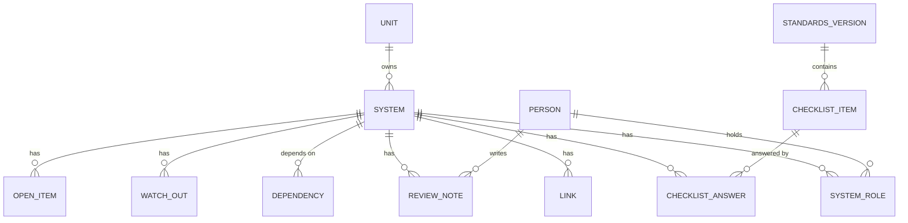

# Data model: T2Gen Internal Developer Portal

*Version 0.3 · Last updated: 2026-10-29*
*Sources: the App & System Inventory form (`app_inventory_form.gs`) and `T2GEN-STANDARDS.md` (7 development steps, standards A1 to G2)*

## Design rules

1. **A system's page is a handover guide.** Developers answer seven questions ([handover guide](handover-guide.md)); catalog fields are for audit and filled separately.
2. **A system is the centre of everything.** Each app, platform, SaaS tool, database, pipeline or script gets one record. Git is optional: a source repository is just one kind of link.
3. **Standards are data, not code.** The IT team changes checklist items without a developer changing the app.
4. **Only answers are stored.** "Not yet required" is worked out from the system's step, so it never goes stale.
5. **People are records, not typed names.** Ownership stays searchable ("what does Tong own?") and correct when people leave.
6. **Everything has a history.** Who changed what, and when, is recorded for every save.
7. **Guide, don't block.** A system can move to any step. Missing items are shown, not enforced ([premise 1](premises.md)).

## Diagram

## Development steps

| Step | Name |
|---|---|
| 1 | Understand the problem |
| 2 | Plan and design |
| 3 | Write the code |
| 4 | Test |
| 5 | Release |
| 6 | Run and maintain |
| 7 | Improve and repeat |

## Entities

### System
The catalog entry. Its fields come in two groups:

- **Guide fields**, which developers fill in: `description` (*what it does*), `if_down`, `run_steps`, `deploy_steps`, `rollback_steps`. Step fields hold one step per line.
- **Catalog fields**, which auditors fill in: the rest of the inventory form, except the ones that become their own entities (see the mapping below).

| Field | Notes |
|---|---|
| `id` | `APP-012` style. Assigned by the portal, never reused. |
| `name`, `aliases` | Inventory section 1 |
| `description`, `if_down` | Guide question 1. `business_purpose` is copied into `if_down` once, then dropped |
| `run_steps`, `deploy_steps`, `rollback_steps` | Guide question 3 |
| `type` | Web app, Internal tool, Platform, SaaS, Database, Pipeline, Script, Infrastructure |
| `step` | 1 to 7 (see above) |
| `lifecycle_state` | Active · Maintenance-only · Deprecated · Retired |
| `owning_unit_id` | → Unit |
| `criticality`, `data_classification`, `internal_or_external`, … | The rest of inventory sections 3 to 8, as typed fields |
| `standards_version_id` | Which standards version this system is checked against |
| `verified_at`, `verified_by_id` | When the record was last confirmed true |

### Person and Unit
`Person`: name, email, unit, is_admin, is_auditor, and the sign-in account: status (`no_account`, `pending`, `active`, `suspended`), password_hash, email_verified, last_sign_in_at, and the failed-login lockout. Auditors edit catalog fields on any system. Created at sign-up, or by an owner adding someone who hasn't signed up yet (`no_account`; signing up later takes over that record). `Unit`: name, parent unit.

### System role
`system_id`, `person_id`, `role`: Business owner · Technical owner · Backup owner · Developer · Support contact · Previous owner. Optional `reachable_until` (date) and `note` ("ask about the billing part"). The **bus factor** is the number of distinct technical owners, backup owners and developers.

### Link
`system_id`, `kind` (Production URL · Source repo · Logs · Dashboard · Secrets location · Brief · Architecture · Decision record · README · Test plan · Runbook · Changelog · Other), `url`, `label`. Docs are links, so they can live in GitLab, Google Drive or anywhere else.

### Dependency
`from_system_id`, then `to_system_id` **or** `external_name` (for things outside the catalog), and `note`. Shared platforms (HPC, MinIO, SSO) are systems of type Platform or Infrastructure. Each dependency is stored once; "used by" is the same row read from the other side.

### Watch-out item
Guide question 4. `system_id`, `kind` (Trap · Chore), `text`, `how_often` (chores only: Weekly · Monthly · Yearly · Other), `next_due` (date, optional), `sort_order`. `known_issues` is moved into traps once, then dropped.

### Open item
Guide question 7. `system_id`, `kind` (Unfinished work · Promise · Open decision), `text`, `promised_to` (promises only), `due_date` (optional), `done_at`, `done_by_id`. `roadmap_notes` is moved into unfinished work once, then dropped.

### Standards version and checklist item
`StandardsVersion`: `version`, `status` (Draft · Current · Retired), `published_at`.

`ChecklistItem`: `code` (such as `C2`, the same as `T2GEN-STANDARDS.md`), `category`, `title`, `from_step`, `level` (Required · Recommended), `applies_to_types` (empty means all), `how_to_verify`, `kb_url`, `auto_rule`.

### Checklist answer
One per system per item: `status` (Done · Partly done · Missing · Not applicable), `evidence` (text or link), `updated_by_id`, `updated_at`.

Some items are answered by the portal itself (`auto_rule`):

| Item | Rule |
|---|---|
| A2 Code in the shared Git repository | Done when the system has a Source repo link |
| F3 Backup person named | Done when the system has a Backup owner |
| G1 Listed in the system register | Always done: the portal is the register |

### Review note
`system_id`, `reviewer_id`, `date`, `where` (Team meeting · In the portal · Other), `step` (the step the system was at), `note`. Written by a leader or peer after reviewing in a meeting or reading the system's page.

### Change history
`entity`, `entity_id`, `field`, `old_value`, `new_value`, `changed_by_id`, `changed_at`. Written automatically on every save.

## Inventory form mapping

| Inventory field | Goes to |
|---|---|
| Business, technical and backup owner; Support contact | System role (matched to Person) |
| Owning unit | Unit |
| Depends on, Dependent systems | Dependency (stored once) |
| Production URL, Source repo, Documentation, Runbook, Architecture diagram | Link |
| Status | `step` and `lifecycle_state`: Idea → 1, In development → 3, Production → 6, Maintenance-only → 6 + Maintenance-only, Deprecated → 6 + Deprecated, Retired → 6 + Retired |
| Passed the Review Gate | Not imported (review gates no longer exist) |
| Bus factor | Calculated from System role |
| Date checked, Checked by | `verified_at`, `verified_by_id` |
| Everything else | A field on System |

Import rule: an owner name that doesn't match a person goes on a "needs matching" list for IT, rather than being guessed.

## Decisions taken for v1
See `docs/decisions/0002-data-model-defaults.md` and `docs/decisions/0003-handover-first.md`.
