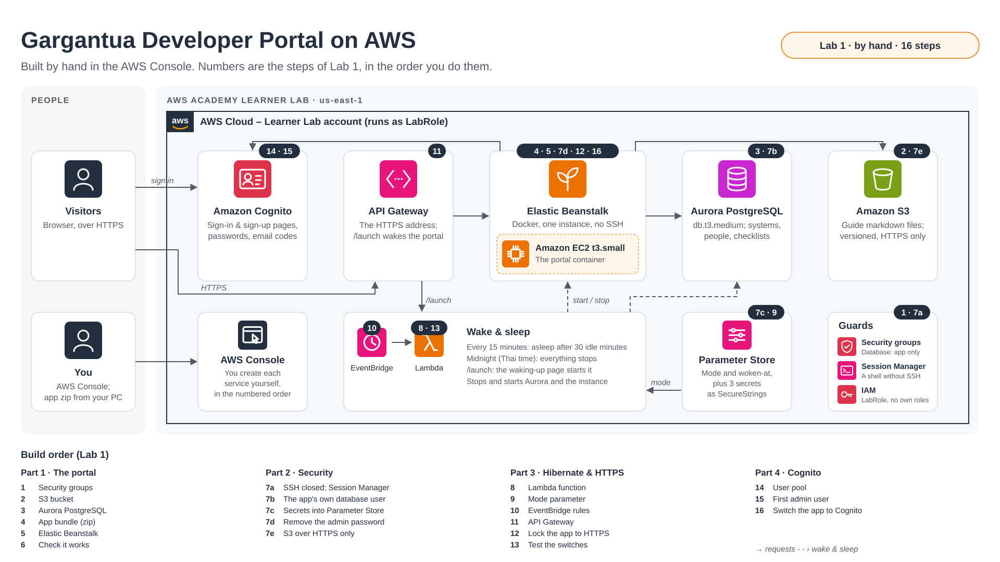
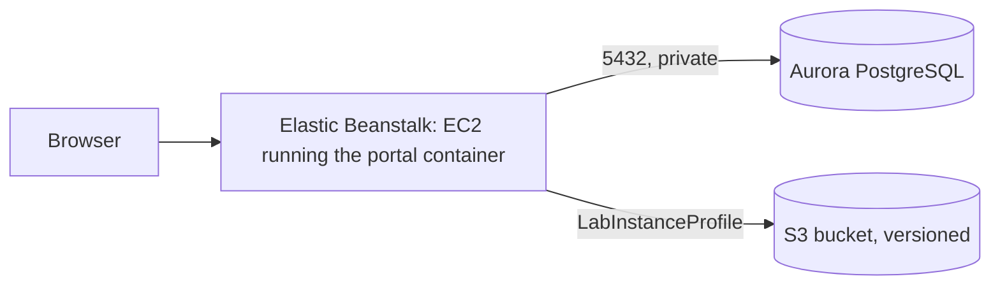
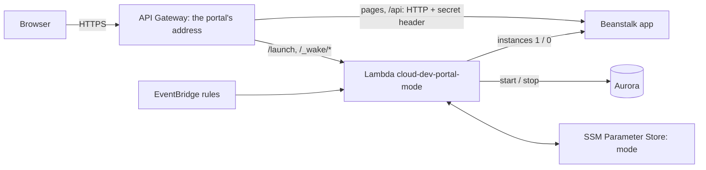

# Lab 1: Build everything by hand

Create every AWS resource yourself in the console, and see what each one does and how they connect. [Lab 2](lab-2-cloudformation.md) builds the same system from one file.

**Time:** most of a day; expect more than one lab session. **Status of these steps:** written from a real build, but not yet followed from start to finish in this order. Part 3's console steps haven't been clicked through, so some button names may differ. Read [Rules of the Learner Lab](lab-common.md#rules-of-the-learner-lab) and [When a lab session ends](lab-common.md#when-a-lab-session-ends) first.

Use **either** this lab **or** Lab 2, not both: they use the same names. Tag what you create as described in [Tags](lab-common.md#tags).



| Part | You build | Services |
| --- | --- | --- |
| [1. The portal](#part-1-the-portal) | The app running on AWS | EC2 security groups, S3, Aurora, Elastic Beanstalk |
| [2. Security](#part-2-security) | Least privilege, no standing secrets | RDS user, SSM Parameter Store, S3 policy, Session Manager |
| [3. Hibernate and HTTPS](#part-3-hibernate-and-https) | Sleeping when idle, waking on a visit, HTTPS | Lambda, SSM, EventBridge, API Gateway |
| [4. Sign-in with Cognito](#part-4-sign-in-with-cognito) | Passwords kept outside the app | Cognito |

**You'll need** a computer with Git, and the project:

```bash
git clone https://github.com/EpistemeHobo/black-cloud-portal.git
```

---

# Part 1: The portal



## Step 1. Security groups

EC2 → **Security Groups** → **Create security group**, both in the default VPC. Create `portal-app-sg` first: the rule on `portal-db-sg` points to it.

| Name | Inbound rules | Purpose |
| --- | --- | --- |
| `portal-app-sg` | none | Put on the portal's EC2 instance, so the database can trust it |
| `portal-db-sg` | Type **PostgreSQL** (5432), source: `portal-app-sg` | Put on Aurora: only the portal can reach it |

For the source, click the search box and pick `portal-app-sg` from the **Security Groups** list.

## Step 2. S3 bucket for the markdown files

S3 → **Create bucket**:

- **Bucket name:** something unique, e.g. `cloud-dev-portal-docs-<your-student-id>`
- **Block all public access:** on (the default)
- **Bucket Versioning:** **Enable**. Every replaced or removed file stays recoverable.
- **Default encryption:** SSE-S3 (the default)

Write down the name; it becomes `DOCS_BUCKET`.

## Step 3. Aurora PostgreSQL

RDS → **Create database**:

| Setting | Value |
| --- | --- |
| Creation method | **Standard create**. Not Easy create or express configuration: it uses IAM-only database login (the app signs in with a password) and puts the database outside the VPC, and neither can be changed later |
| Engine | **Aurora (PostgreSQL Compatible)**, latest version offered |
| Template | Dev/Test |
| DB cluster identifier | `portal-db` |
| Master username | `portal` |
| Credentials management | **Self managed**, type a password (letters and digits are easiest) and write it down |
| Cluster storage configuration | Aurora Standard |
| Cluster scalability type | **Provisioned**. Learner Lab refuses Aurora Serverless: creation fails with "not authorized to perform rds:CreateDBInstance … explicit deny" |
| DB instance class | Burstable classes → **db.t3.medium** (or db.t4g.medium), the smallest Aurora PostgreSQL offers. It runs, and bills about $2 a day, until you stop it |
| Multi-AZ | Don't create an Aurora Replica |
| VPC | Default VPC |
| Public access | **No** |
| VPC security group | Choose existing: **`portal-db-sg`**. Remove `default`, or the app can't connect |
| Monitoring | **Turn off Enhanced Monitoring and Performance Insights**. They need an IAM role the lab can't create, and creation fails otherwise |
| Additional configuration → **Initial database name** | **Leave empty**. The app starts in the built-in `postgres` database; step 7b moves it to its own |
| Backup retention | 1 day |
| Deletion protection | Off (so you can delete it at the end of the course) |

If a failed attempt left a `portal-db` cluster with no instance, delete it before trying again.

Creating the cluster takes 5 to 10 minutes. Then open the **cluster** `portal-db` → **Connectivity & security** and copy the **Writer** endpoint (`portal-db.cluster-xxxx.us-east-1.rds.amazonaws.com`). It becomes `DB_HOST`.

## Step 4. Build the app bundle

Beanstalk builds the [Dockerfile](../Dockerfile) on the instance, so it needs the source as a zip. In the project folder:

```bash
git archive -o portal.zip HEAD
```

`git archive` packs only committed files. Check that `Dockerfile` is at the top of the zip.

## Step 5. Elastic Beanstalk

Elastic Beanstalk → **Create application**. Fill in these sections:

**Basic details and platform**

- Application name: `cloud-dev-portal`
- Environment name: `cloud-dev`
- Domain name prefix: `cloud-dev-portal`; if it's taken, add your student ID
- Platform: **Docker**, branch "Docker running on 64bit Amazon Linux 2023", the recommended version

**Application code**

- **Local file** → choose `portal.zip`. Version label: `v1`.

**Environment tier**

- **Web server environment**; environment type: **Single instance** (cheapest; no load balancer)

**Environment properties**: the portal's settings. Add each as source **Plain text**:

| Name | Value |
| --- | --- |
| `ENVIRONMENT` | `staging` (not `production` yet: that requires SMTP) |
| `JWT_SECRET_KEY` | 48+ random characters: `python -c "import secrets; print(secrets.token_urlsafe(48))"` |
| `DB_HOST` | the Aurora writer endpoint |
| `DB_NAME` | `postgres` |
| `DB_USER` | `portal` |
| `DB_PASSWORD` | the Aurora password |
| `DOCS_BUCKET` | your bucket name, without `s3://` |
| `AWS_REGION` | `us-east-1` |
| `SEED_ADMIN_EMAIL` | your email: the first admin |
| `SEED_ADMIN_PASSWORD` | 12+ characters |

> These start in plain text so the first deploy has nothing extra to go wrong: anyone who can open the environment's configuration can read `DB_PASSWORD` and `JWT_SECRET_KEY`, and the app signs in as Aurora's all-powerful master user. [Part 2](#part-2-security) fixes both once the portal works.

**Service access**

- Service role: **Use another role → LabRole**
- EC2 instance profile: **Use another role → LabInstanceProfile**. This is what lets the app use S3 without keys.
- EC2 key pair: **leave empty**. A key pair makes Beanstalk open SSH (port 22) to the whole internet. You get a shell through Session Manager instead, which needs no open port.
- Tags: `Project = cloud-dev-portal`, `Environment = dev`. Not `Name`: Beanstalk reserves it.

**Networking**

- VPC: the default VPC. Tick the subnets it offers.
- EC2 security groups: **`portal-app-sg`**. Beanstalk adds its own too.

**Instance**

- Instance types: **t3.small only**. Remove t3.micro: Beanstalk uses the first in the list, and building the frontend needs about 2 GB of memory.

**Monitoring and updates**

- Health reporting: Basic
- Managed updates: **off**. It needs Enhanced health, and could restart the server during a presentation.
- Command timeout: **1200** seconds, since the first deploy builds the whole image
- Log streaming to CloudWatch: on

Then **Create** (or **Submit**). The first launch takes about 10 minutes.

**Checkpoint.** The environment shows **Green**, and its domain (`http://cloud-dev-portal.us-east-1.elasticbeanstalk.com`) opens the sign-in page. Green alone proves little: Basic health only checks that the instance is alive. Sign in with the seed admin.

Then add one more property, so links in emails point to the portal: `PUBLIC_BASE_URL` = that address, starting with `http://`.

## Step 6. Check it works

1. Register a system, open its handover guide, and attach a `.md` file.
2. S3 → your bucket: the file is at `systems/<id>/<question>/<file>.md`. Replace it in the portal, then turn on **Show versions** in S3 to see both copies.
3. Emails (sign-up verification, password reset) are in the log, not sent: Beanstalk → **Logs → Request logs → Last 100 lines**.

**Deploying a new version** at any time: run `git archive -o portal.zip HEAD` again, then Beanstalk → your environment → **Upload and deploy** → choose `portal.zip`, with a new version label.

To add four demo systems, open a shell on the instance (EC2 → the instance → **Connect** → **Session Manager** → **Connect**) and run:

```bash
sudo docker exec $(sudo docker ps -q) python -m app.seed --demo
```

---

# Part 2: Security

The portal works; now take away everything it doesn't need. Two principles:

- **Least privilege:** each part gets only the access its job needs, so a mistake or a break-in in one part can't reach further.
- **No standing authority:** secrets and admin powers aren't left lying around (in plain text, in settings, on open ports) once their job is done.

| Step | Change | Before | After |
| --- | --- | --- | --- |
| 7a | No SSH | Possibly port 22 open to the internet | Shell through Session Manager only |
| 7b | The app's own database user | App signs in as Aurora's master user | `portal_app`, which owns only its own database |
| 7c | Secrets in SSM | Passwords in plain text in Beanstalk | Encrypted SecureStrings, linked by ARN |
| 7d | No seed admin password | Admin password kept in the configuration | Removed after the first sign-in |
| 7e | S3 over HTTPS only | Bucket answers plain HTTP | Plain HTTP refused |
| 8 | HTTPS for the browser | `http://` Beanstalk address | `https://` API Gateway address (Part 3) |

## Step 7a. Check that SSH is closed

EC2 → **Security Groups** → the group whose name starts with `awseb-`: **Inbound rules** should show only **HTTP 80**.

If you chose a key pair in step 5, there's a rule for port 22 open to `0.0.0.0/0`. Remove the key pair: Beanstalk → **Configuration** → **Service access** → **Edit** → EC2 key pair: none → **Apply**. Beanstalk replaces the instance and removes the rule.

**A shell without SSH:** EC2 → the instance → **Connect** → **Session Manager** → **Connect**. It goes through the Systems Manager agent on the instance (LabInstanceProfile allows it), with no open port and no key file to lose.

## Step 7b. The app's own database user

The app signs in as `portal`, Aurora's master user, which may do anything to every database on the server. Give it a user that owns only its own database. Open a shell with Session Manager and run:

```bash
sudo docker exec $(sudo docker ps -q) python -m app.app_db_user --param /cloud-dev-portal/db-password
```

It uses the app's current (master) settings to create the user **`portal_app`** and the database **`portal`**, which only `portal_app` may connect to. It creates the tables there as `portal_app`, copies every row across, and stores `portal_app`'s new password in SSM Parameter Store as an encrypted SecureString, without ever printing it. The output ends with:

```
Password stored in SSM as /cloud-dev-portal/db-password (SecureString).
```

The old tables stay in `postgres`, untouched. If it stops with an error, run it again: it's safe, since the copy happens in one transaction.

Don't apply anything yet: 7c links the new password. From now on the master password is needed by nobody but you, for running steps like this one. Keep it in a password manager, not in a file.

## Step 7c. Secrets into SSM Parameter Store

1. Make a new session key:

```bash
python -c "import secrets; print(secrets.token_urlsafe(48))"
```

2. Systems Manager → **Parameter Store** → **Create parameter**: name **`/cloud-dev-portal/jwt-secret-key`**, type **SecureString** (KMS key: the default `alias/aws/ssm`), value: the key.
3. Beanstalk → **Configuration** → **Updates, monitoring, and logging** → **Edit** → Environment properties. Change these rows:

| Name | Source | Value |
| --- | --- | --- |
| `DB_USER` | Plain text | `portal_app` |
| `DB_NAME` | Plain text | `portal` |
| `DB_PASSWORD` | **SSM Parameter Store** | `arn:aws:ssm:us-east-1:<account id>:parameter/cloud-dev-portal/db-password` |
| `JWT_SECRET_KEY` | **SSM Parameter Store** | `arn:aws:ssm:us-east-1:<account id>:parameter/cloud-dev-portal/jwt-secret-key` |

Your account ID is the 12-digit number in the top-right account menu. Beanstalk reads the values on the instance at each deploy, through the instance profile, so they never appear in the configuration.

## Step 7d. Remove the seed admin password

The admin account exists since the first start; the app needs `SEED_ADMIN_PASSWORD` only to create it. In the same form, **Remove** the `SEED_ADMIN_PASSWORD` row. Keep `SEED_ADMIN_EMAIL`: it's the contact shown on the sign-in page. Keep the password in a password manager, and delete it from any local file.

Now **Apply** 7b to 7d together: one restart. The new session key signs everyone out once.

**Checkpoint.** The portal works and you can sign in, with your systems still there. The environment's properties show no password in plain text.

## Step 7e. S3 over HTTPS only

S3 → your bucket → **Permissions** → **Bucket policy** → **Edit**: paste [infra/iam/docs-bucket-policy.json](../infra/iam/docs-bucket-policy.json) with `BUCKET_NAME` replaced by your bucket's name (twice) → **Save**. Any request that isn't encrypted is now refused; the app already uses HTTPS.

Some things the lab can't do, such as least-privilege IAM roles: see [What the lab doesn't allow](lab-common.md#what-the-lab-doesnt-allow).

---

# Part 3: Hibernate and HTTPS

Two modes, switched with one click, and one HTTPS address:

| | **Active** (presentation days) | **Hibernate** (development days) |
| --- | --- | --- |
| Aurora and the Beanstalk instance | Always on | Asleep when nobody uses the portal |
| Goes to sleep | When you switch to hibernate, or at midnight at the latest | After 30 minutes without visitors (checked every 15 minutes), and at midnight |
| Opening the site | Instant | Through the **launcher link** (`…/launch`): while asleep it shows a "waking up" page, and forwards to the portal after about 5 minutes |
| Cost | About $2.50 a day | Storage only while asleep |



- **API Gateway is the portal's address** (`https://…execute-api…`). It passes the portal's pages to Beanstalk and adds a secret header; the app refuses requests without it, so the HTTPS address is the only way in.
- **The launcher link** is that address plus `/launch`: share it. While the portal is awake it forwards straight to the portal; while it sleeps it shows the waking-up page.
- **The waking-up page** asks the Lambda function to start Aurora and the Beanstalk instance, checks every 10 seconds, and forwards to the portal when both are up.
- **EventBridge** runs the function every 15 minutes. In hibernate mode it asks the portal how long it has been idle (`/api/health` reports it) and puts it to sleep after 30 minutes. In active mode it only makes sure everything is still on.
- **At midnight**, a second rule switches to hibernate and stops everything, whatever the mode: a safety net in case active mode was left on. It may not run with no lab session open ([why](lab-common.md#when-a-lab-session-ends)).
- **The mode** is kept in SSM Parameter Store, `/cloud-dev-portal/mode`.

The function is in [infra/portal_mode/](../infra/portal_mode/). [infra/portal_mode.zip](../infra/portal_mode.zip) is the same, ready to upload; `python scripts/build_lambda_zip.py` rebuilds it.

You build the pieces in the order they depend on each other: the function first, since everything else calls it.

## Step 8. Lambda function

1. Lambda → **Create function** → **Author from scratch**.
   - Function name: **`cloud-dev-portal-mode`**
   - Runtime: **Python 3.12**
   - Permissions → *Change default execution role* → **Use an existing role** → **LabRole**
   - **Create function**.
2. **Code** tab → **Upload from** → **.zip file** → choose `infra/portal_mode.zip` → **Save**. The file list on the left now shows `handler.py` and `wake.html`.
3. **Code** tab → **Runtime settings** → **Edit** → Handler: **`handler.lambda_handler`** → **Save**.
4. **Configuration** → **General configuration** → **Edit** → Timeout: **30 sec** → **Save**. Starting Aurora and reading the app's state takes longer than the default 3 seconds.
5. **Configuration** → **Environment variables** → **Edit** → add:

| Key | Value | Meaning |
| --- | --- | --- |
| `DB_CLUSTER_ID` | `portal-db` | The Aurora cluster to start and stop |
| `EB_ENVIRONMENT` | `cloud-dev` | The Beanstalk environment whose instance count changes |
| `PARAM_PREFIX` | `/cloud-dev-portal` | Where step 9's parameter lives |
| `IDLE_MINUTES` | `30` | In hibernate mode, sleep after this many minutes without visitors |

**Checkpoint.** **Test** tab → Create new event, name `status`, Event JSON `{"action": "status"}` → **Test**. The result shows the portal's state:

```json
{"mode": "hibernate", "database": "available", "app_instances": 1, "app_answers": true, "idle_minutes": 2, "ready": true}
```

`"mode"` says `hibernate` until step 9 is done; that's expected.

## Step 9. SSM parameter

Systems Manager → **Parameter Store** → **Create parameter**:

- Name: **`/cloud-dev-portal/mode`**
- Tier: Standard · Type: **String** · Data type: text
- Value: **`active`**. Start in active, so nothing goes to sleep while you build the rest.

**Checkpoint.** Run the `status` test event again: `"mode"` is now `active`.

## Step 10. EventBridge rules

EventBridge works as the system's clock: a **rule** calls a target (the function) on a schedule, with a message you choose. No code: you fill in a form. You create two rules.

**The idle check, every 15 minutes.** EventBridge → **Rules** → **Create rule**:

1. Name: **`cloud-dev-portal-tick`**. Event bus: default. Rule type: **Schedule**.
   If the console suggests **EventBridge Scheduler**, choose **Continue in EventBridge rules** instead: Scheduler needs an IAM role of its own, which Learner Lab can't create, while a rule calls Lambda directly.
2. Schedule pattern: **A schedule that runs at a regular rate** → **15 minutes**.
3. Target: **AWS service** → **Lambda function** → **`cloud-dev-portal-mode`**.
   - **Additional settings** → Configure target input: **Constant (JSON text)** → `{"action": "tick"}`
4. **Create rule**.

**The midnight shutdown.** Create a second rule the same way, with:

- Name: **`cloud-dev-portal-nightly-stop`**
- Schedule pattern: **A fine-grained schedule (cron expression)** → `0 17 * * ? *`
- Target: the same function. Target input: **Constant (JSON text)** → `{"mode": "hibernate"}`

This is the same message as the `hibernate` switch: it sets the mode to hibernate and stops the instance and Aurora at once, whatever the mode was and whether anyone is using the portal.

Rule schedules are in **UTC**: `0 17 * * ? *` means 17:00 UTC every day, which is **midnight in Thailand** (UTC+7). For another time zone, subtract its offset from midnight (e.g. UTC+9: `0 15 * * ? *`).

**Checkpoint.** After 15 minutes, CloudWatch → **Log groups** → `/aws/lambda/cloud-dev-portal-mode` has a new log stream: the idle check ran the function.

## Step 11. API Gateway

The API becomes the portal's front door: two routes go to the function, everything else to the app.

1. **A secret for the app.** API Gateway will add it to every request it passes on, and the app will refuse requests without it, so nobody can go around HTTPS. Make one:

```bash
python -c "import secrets; print(secrets.token_urlsafe(48))"
```

   Systems Manager → Parameter Store → **Create parameter**: name **`/cloud-dev-portal/origin-verify-secret`**, type **SecureString**, value: the secret.
2. API Gateway → **HTTP API** → **Build**:
   - Integrations: **Add integration** → **Lambda** → `cloud-dev-portal-mode`. API name: **`cloud-dev-portal-wake`** → **Next**.
   - Routes: **`ANY /launch`** and **`ANY /_wake/{proxy+}`**, both to the Lambda integration → **Next**.
   - Stages: **`$default`**, **Auto-deploy** on → **Next** → **Create**.
3. **Routes** → **Create**: **`ANY /{proxy+}`**. Select it → **Attach integration** → **Create and attach an integration**: type **HTTP URI**, method **ANY**, URL **`http://<environment domain>/{proxy}`**, e.g. `http://cloud-dev-portal.us-east-1.elasticbeanstalk.com/{proxy}`.
4. **Routes** → **Create**: **`ANY /`**, attached the same way to a new HTTP URI integration with URL **`http://<environment domain>/`**.
5. **Integrations** → each of the two HTTP URI integrations → **Parameter mapping** → **Create parameter mapping**: mapping type **All incoming requests**; parameter **`header.x-origin-verify`**, modification **Overwrite**, value: the secret from 1. "Overwrite" also replaces any such header a visitor sends.
6. **Protect** → **Throttling**: the `$default` stage's default: rate **50**, burst **100** (a page load fetches about 20 files). Then **route-level** throttling for `ANY /launch` and `ANY /_wake/{proxy+}`: rate **5**, burst **10**. Those can start servers, so anyone with the link gets only a little.
7. Copy the API's **Invoke URL**, e.g. `https://abc123defg.execute-api.us-east-1.amazonaws.com`: the **portal's address**. The **launcher link** is that plus `/launch`.

**Checkpoint.** Open the Invoke URL: the portal's sign-in page, with `https://` and the API's address in the address bar. Open the launcher link: since the portal is awake, it forwards to the same page.

## Step 12. Lock the app to the HTTPS address

Beanstalk → **Configuration** → **Updates, monitoring, and logging** → **Edit** → Environment properties: add

| Name | Source | Value |
| --- | --- | --- |
| `ORIGIN_VERIFY_SECRET` | **SSM Parameter Store** | `arn:aws:ssm:us-east-1:<account id>:parameter/cloud-dev-portal/origin-verify-secret` |
| `COOKIE_SECURE` | Plain text | `true` (sign-in cookies are sent over HTTPS only) |
| `PUBLIC_BASE_URL` | Plain text | the Invoke URL (links in emails); replace the old value |

→ **Apply**.

**Checkpoint.** The Beanstalk address now answers "เปิดพอร์ทัลผ่านที่อยู่ HTTPS ของพอร์ทัล" (open the portal through its HTTPS address), while the Invoke URL works and you can sign in there.

## Step 13. Save the switches, and test the whole system

Lambda → `cloud-dev-portal-mode` → **Test** tab: save three more test events.

| Event name | Event JSON | When |
| --- | --- | --- |
| `active` | `{"mode": "active"}` | Presentation days, at least 15 minutes before you start |
| `hibernate` | `{"mode": "hibernate"}` | Development days, and **before a lab session ends** |
| `wake` | `{"action": "wake"}` | Starts everything now, staying in hibernate |

To switch, choose the event and press **Test**. Or from a terminal: [commands.md](commands.md#switch-modes).

**Checkpoint: the whole system.**

1. Run **`hibernate`**. The result shows `"app_instances": 0`.
2. Wait until RDS shows `portal-db` as **Stopped** (about 6 minutes) and EC2 shows no running instance for the environment.
3. Open the launcher link: the waking-up page appears, its two dots turn orange, then green after about 5 minutes, and it forwards to the portal by itself.
4. Leave it unused: within 45 minutes (30 idle minutes plus up to 15 until the next tick) Aurora stops again.

**Things to know:**

- While asleep, Beanstalk shows the environment as **Severe** or **No data**: expected, it has no instance. The portal's pages don't answer then (`Service Unavailable`); the launcher link is the one that wakes it.
- **Wake it before deploying a new version.** A deploy to a sleeping environment fails.
- Each wake builds the app on a fresh instance. A later improvement: build the image once into ECR so the instance only downloads it.
- If a switch fails with `AccessDenied`, LabRole doesn't allow that action in your course (`rds:StartDBCluster`/`StopDBCluster`, `autoscaling:UpdateAutoScalingGroup`, `elasticbeanstalk:DescribeEnvironmentResources`, `ssm:PutParameter`). Then stop and start Aurora by hand: [Costs](lab-common.md#costs).

---

# Part 4: Sign-in with Cognito

Until now the portal stores password hashes and needs an email service to confirm addresses. Here Cognito takes over passwords, email codes and forgotten passwords. The portal still decides who may enter: new people wait for an admin's approval, and admin rights stay in the portal.

1. The portal's button sends the browser to Cognito's page, on an `amazoncognito.com` address. People type their password there, so the app never sees it. The page is in English, and only its logo and colours can be changed.
2. Cognito sends the browser back to `/api/auth/callback` with a one-time code.
3. The app swaps the code for an ID token, checks its signature and contents, and sets its usual session cookie. It doesn't keep the token.

**Status of these steps:** the settings below were created through the API and tested against the real app. Only the Create user form has been used in the console, so other button names may differ.

The app must be a version with Cognito sign-in. If you built your bundle before this part existed, repeat [Step 4](#step-4-build-the-app-bundle) and deploy it.

## Step 14. User pool

Cognito → **User pools** → **Create user pool**.

| Setting | Value | Why |
| --- | --- | --- |
| Application type | **Single-page application (SPA)** | It has no client secret. The app uses PKCE instead, so there's no secret to protect. A "traditional web application" would create one, and the app doesn't send it |
| Application name | `portal` | |
| Sign-in identifiers | **Email** | |
| Self-registration | On | People can ask for an account |
| Required attributes for sign-up | **name** | The portal shows it |
| Return URL | your Invoke URL + `/api/auth/callback` | Cognito only sends people back to addresses listed here |

Name the pool `cloud-dev-portal`. Then adjust it:

1. **Sign-in → Password policy:** minimum length 12, with no character rules: length protects better than forcing symbols.
2. **App clients → `portal` → Login pages → Edit:** add your Invoke URL + `/` as an **Allowed sign-out URL**. It must match exactly, including the `/`. OAuth grant type: **Authorization code grant**. Scopes: **OpenID**, **Email**, **Profile**.
3. **Domain:** note the Cognito domain, in the form `https://<prefix>.auth.us-east-1.amazoncognito.com`. A prefix may not contain `aws`, `amazon` or `cognito`.
4. **Managed login → Styles:** optional. Match the portal's sign-in page by turning off the page's background image and using page colour `#090a11`, button colour `#1c1e22` and link colour `#0f172a`. The full list is under `SignInPages` in [infra/full-stack.yaml](../infra/full-stack.yaml). To get the portal's twinkling dots too, upload [infra/signin-background.svg](../infra/signin-background.svg) as the page background. A change can take a couple of minutes to appear.

Wait about 2 minutes before opening that address. If you open it too early, your DNS server can remember that it doesn't exist; see [When something goes wrong](lab-common.md#when-something-goes-wrong).

## Step 15. First admin

Two settings with the same email make an admin: Cognito holds the login, and `SEED_ADMIN_EMAIL` tells the portal it's an admin.

User pool → **Users** → **Create user**:

- **Send an email invitation**
- **Email address:** the same as `SEED_ADMIN_EMAIL`, exactly. Check it for typos: the temporary password goes there
- **Mark email address as verified:** on. The portal refuses unverified addresses, so nobody can claim someone else's
- **Generate a password**

## Step 16. Switch the app to Cognito

Beanstalk → **Configuration → Updates, monitoring, and logging → Environment properties**:

| Name | Value |
| --- | --- |
| `COGNITO_USER_POOL_ID` | the pool's ID, such as `us-east-1_AbC123` |
| `COGNITO_CLIENT_ID` | the app client's ID |
| `COGNITO_DOMAIN` | the domain from step 14, with `https://` |

Check that `PUBLIC_BASE_URL` is still your Invoke URL. The app builds its return address from it, and it must match step 14. Press **Apply**.

**Checkpoint.**

1. Open the Invoke URL. The email and password form is gone, and a **เข้าสู่ระบบ** button leads to Cognito's page.
2. Sign in with the temporary password from the email. The sentence in the email ends with a full stop, which isn't part of the password. Choose your own password when asked: you land in the portal as admin, with your systems still there, because the same email links to your existing account.
3. In a private window, press **สมัครใช้งาน**, sign up with another email and enter the emailed code. The portal says the account waits for approval. As admin, approve it under **จัดการคำขอ**.
4. Try the old route, by running the command below with your Invoke URL. It answers `404`: the portal's own passwords no longer work.

```bash
curl -s -o /dev/null -w "%{http_code}\n" -X POST https://YOUR-INVOKE-URL/api/auth/login
```

**Things to know:**

- Cognito's built-in email sends at most 50 messages a day per account.
- Failed sign-ins now happen at Cognito, so the portal's activity log no longer shows wrong passwords.
- Admin rights never come from Cognito. To make someone else an admin, use the portal's **ผู้ใช้** page.

---

# Clean up

Do this at the end, or before [Lab 2](lab-2-cloudformation.md), which needs the same names. In this order, because each depends on the next:

0. **Part 4:** Cognito → delete the domain of the user pool `cloud-dev-portal`, then the pool. Its users go with it, so you don't delete them one by one.

1. **Beanstalk:** terminate the environment `cloud-dev`, then delete the application `cloud-dev-portal`. Wait until it's gone (up to about 20 minutes).
2. **Part 3:** API Gateway → delete `cloud-dev-portal-wake`. EventBridge → delete both rules. Lambda → delete `cloud-dev-portal-mode`.
3. **Aurora:** start it if it's stopped, since a stopped cluster can't be deleted. RDS → delete the instance `portal-db-instance-1`, then the cluster `portal-db`: skip the final snapshot.
4. **Security groups:** edit `portal-db-sg` and remove its inbound rule (it points to the other group). Delete `portal-app-sg`, then `portal-db-sg`.
5. **S3:** empty your bucket (versions too), then delete it.
6. **SSM:** delete every parameter under `/cloud-dev-portal/`.

## Questions to think about

1. Why does `portal-db-sg` refer to `portal-app-sg` instead of an IP address?
2. Before step 7b, what could a bug in the app do to the database that it can't do afterwards?
3. Which secrets could an attacker read from the Beanstalk configuration page, before and after step 7c?
4. Why is the function's mode kept in SSM, and not in a variable in the code?
5. Which pieces cost money while nobody is using the portal? Which don't, and why?
6. After Part 4, what could an attacker who steals the portal's database learn about passwords, compared with before?
