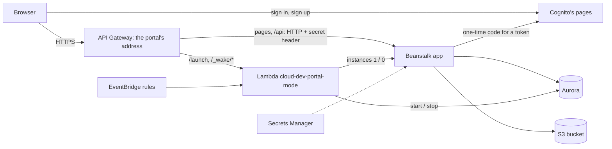

# Lab 2: Build everything with CloudFormation

Build the whole portal from one file, then delete all of it with one button. [Lab 1](lab-1-by-hand.md) builds the same system by hand.

**Time:** about 12 minutes to build, 11 to 17 to delete ([measured](stack-test-log.md)). **Tested:** the stack without Cognito, from start to finish. Cognito was tested on its own against the running app ([log](stack-test-log.md#cognito)); the stack hasn't yet been built with it. Read [Rules of the Learner Lab](lab-common.md#rules-of-the-learner-lab) and [When a lab session ends](lab-common.md#when-a-lab-session-ends) first.

## The idea

A **template** is a text file describing the resources you want: [infra/full-stack.yaml](../infra/full-stack.yaml). A **stack** is the real, running resources CloudFormation builds from it, tracked as one group. The file doesn't change when it's used, so you can build, delete and build again as often as you like, paying only while the stack exists.

Use **either** this lab **or** Lab 1, not both: they use the same names (`portal-db`, `cloud-dev`, `portal-app-sg`…), so anything left from Lab 1 makes the stack fail.

**What it builds:** two security groups, a private and versioned S3 bucket that refuses plain HTTP, Aurora, generated secrets, a Cognito user pool with its sign-in pages and your admin user, the Beanstalk application and environment (no key pair, so no SSH), the Lambda function, the `mode` parameter, two EventBridge rules, and the API Gateway HTTPS address.

**What differs from Lab 1, and why:**

| | Lab 1 | Lab 2 | Why |
| --- | --- | --- | --- |
| Secrets | SSM SecureStrings | **Secrets Manager** | CloudFormation can't create SecureStrings, but it can generate secrets here. Nobody ever chooses them |
| The app's database user | You run a script once | **The container creates it on start** | Nobody is there to run a script. The master password stays in its secret; the app is given only that secret's ARN |
| First admin | You create the Cognito user | **The stack creates it** | `AdminEmail` sets both the Cognito user and the portal's admin. Cognito emails the temporary password, so no secret store ever holds it |
| Code | You upload zips | **Fetched from GitHub** | A small function downloads the repository, which must be public, when the stack is created |

## Create the stack

You can do this in the console, as below, or with one command: see [commands.md](commands.md).

1. Start the lab and open the console from the lab page, with at least **30 minutes** left in the session.
2. Download [infra/full-stack.yaml](../infra/full-stack.yaml) from the repository.
3. CloudFormation → **Create stack** → **With new resources (standard)** → *Choose an existing template* → **Upload a template file** → choose the file → **Next**.
4. Stack name: **`gargantua`**. Parameters:
   - `AdminEmail`: the email you'll sign in with. Required, and check it carefully: the temporary password goes here.
   - `GitHubRepo`: your copy of the repository, if you forked it. It must be public.
   - `DomainPrefix`: if `cloud-dev-portal` is taken, add your student ID.
   - Leave the rest as they are.
5. **Next** → Tags: `Project = cloud-dev-portal`, `Environment = dev`. Permissions: leave the IAM role empty. Stack deployment options: on **Behavior on provisioning failure**, select **Roll back all resources**, and on **Delete newly created resources during a rollback**, select **Delete all newly created resources**, so a failed attempt leaves nothing behind → **Next** → **Submit**.
6. Watch the **Events** tab, with the newest at the top. Aurora takes about 6 minutes and Beanstalk about 6 more. A stack named `awseb-…` appears too: Beanstalk made it, and deleting `gargantua` removes it. Leave it and the Learner Lab stack (`c…`) alone.

The stack finishes with **CREATE_COMPLETE**, but that doesn't prove the app started: Beanstalk counts its environment as created even if the app crashes. The checkpoint below is the real test.

## Checkpoint

1. `gargantua` → **Outputs** → open `PortalUrl`: the Gargantua sign-in page over HTTPS. If it shows `Service Unavailable`, the app is still starting: try again in a few minutes.
2. Find the email from `no-reply@verificationemail.com`, and check spam. It arrives during the build. Press **เข้าสู่ระบบ**, and on Cognito's page sign in with `AdminEmail` and the temporary password. The sentence in the email ends with a full stop, which isn't part of the password. Choose your own password when asked: you land in the portal as admin.
3. Open the portal in a private window and press **สมัครใช้งาน**. Sign up with another email and enter the emailed code: the portal says the account waits for approval. As admin, approve it under **จัดการคำขอ**.
4. Register a system, open its handover guide and attach a `.md` file. S3 → the bucket named in `DocsBucketName`: it appears under `systems/`.
5. Open the Beanstalk address (`http://cloud-dev-portal.us-east-1.elasticbeanstalk.com`): it refuses you with "เปิดพอร์ทัลผ่านที่อยู่ HTTPS ของพอร์ทัล". That's the lock working: HTTPS is the only way in.

Each new stack has a **new address, a new temporary password**, and an empty database with no users. Get the address from **Outputs** each time. Share `LauncherUrl`, not `PortalUrl`: it wakes the portal if it's asleep.

## Switch modes

The stack starts in **active**: Aurora and the instance stay on. Switch with [the script](commands.md#switch-modes), or in the console: Lambda → `cloud-dev-portal-mode` → **Test** tab → save these as test events, then choose one and press **Test**.

| Event name | Event JSON | What it does |
| --- | --- | --- |
| `active` | `{"mode": "active"}` | Presentation days: starts everything and keeps it on |
| `hibernate` | `{"mode": "hibernate"}` | Development days: stops everything now. It wakes through the launcher link, and sleeps again after 30 minutes without visitors |
| `wake` | `{"action": "wake"}` | Starts everything now, staying in hibernate |
| `status` | `{"action": "status"}` | Shows the state; everything is up when `"ready"` is `true` |

**Checkpoint.** Run `hibernate`. Wait until RDS shows `portal-db` as **Stopped** (about 6 minutes). Open `LauncherUrl`: the waking-up page appears, and it forwards to the portal by itself after about 5 minutes.

## Reset: delete the stack

CloudFormation → `gargantua` → **Delete stack**. It removes everything above. It takes 11 to 14 minutes, or about 17 if Aurora is asleep: it empties the bucket first, and starts Aurora first if it's asleep, since CloudFormation can't delete a stopped cluster.

**All portal data and Cognito users are lost,** by design: there's no final snapshot. Start it with **at least 30 minutes left** in the session. Check that the stack disappears from the list; if it shows **DELETE_FAILED**, open **Events** for the reason and press **Delete** again. Also check that no red `awseb-…` stack remains: a delete cut off by the session's end [can leave pieces behind](lab-common.md#if-a-delete-was-cut-off).

Two things stay, and they cost next to nothing: Beanstalk's own bucket `elasticbeanstalk-us-east-1-<account id>`, and the parameter `/cloud-dev-portal/woken-at`, which the function creates by itself.

**Before the session ends,** run `hibernate` or delete the stack: Aurora bills about $2 a day while it runs ([more](lab-common.md#when-a-lab-session-ends)).

## Questions to think about

1. Open **Resources**: how many of these did you click through in Lab 1? What decided the order they were built in?
2. Why does the Lambda function use `LabRole`, and what would you attach instead in a real account? ([infra/iam/](../infra/iam/))
3. Why isn't `CREATE_COMPLETE` enough to know the portal works?
4. What would you change in the template to run a second copy of the portal in the same account?
5. Cognito knows who someone is, so why does the portal still keep its own approval and admin flags?
